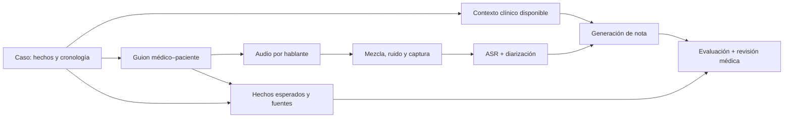

# Bag of ideas — datos y evaluación de un escriba médico

Draft del **09/10/2026**, para ampliar el cierre de la técnica. Son experimentos posibles; las cifras propuestas abajo son recortes de trabajo, no tamaños validados de estudio.

## 1. Un historial clínico simulado como base

**La referencia de Kather Lab es MIRA**, localizada en tu Zotero (`AWH83W73`). Parte de **574 casos reales de MIMIC-IV, ocho diagnósticos**, y simula la atención en un EHR con herramientas FHIR. Un agente paciente responde por texto a partir de la historia de enfermedad actual extraída de notas; el agente médico pregunta, solicita pruebas y toma decisiones. No parte de Synthea ni presenta un corpus de conversaciones habladas para escribas. [Ferber et al., Nature, 2026](https://doi.org/10.1038/s41586-026-10675-5).

Nos interesa reutilizar la separación entre **caso, información disponible e interacción**. Crear guiones, audio y notas sería nuestra extensión.

- [Código de MIRA](https://github.com/Dyke-F/MIRA) — Extracción de casos, agentes, herramientas y servidor FHIR; reconstruir sus datos requiere acceso autorizado a MIMIC-IV.
- [Synthea](https://synthetichealth.github.io/synthea/) — Alternativa para generar desde cero historiales longitudinales con condiciones, alergias, medicación y encuentros, exportables a FHIR; sus modelos de partida necesitan adaptación al caso local.
- [HAPI FHIR](https://hapifhir.io/) — Servidor abierto para probar lectura de contexto y escritura de borradores; después habría que validar el conector específico de HCIS.

## 2. Del caso a una prueba de toda la pipeline



Guardar por separado: hechos del paciente, lo visible en el contexto, lo dicho durante la consulta y lo que debe aparecer en la nota. La valoración y el plan esperados salen de lo expresado por el médico del guion.

Ejemplo: varios antecedentes poco relevantes y una alergia que ponemos **solo en la historia**, **solo en la conversación**, **en ambos** o **en ninguno**. También podemos introducir una discrepancia. Si no aparece en ninguna entrada, no exigimos que el escriba la adivine; si el producto debe preguntar por datos pendientes, evaluamos esa función aparte.

Generar voces separadas permite controlar turnos y solapamientos. Conservar audio limpio y variantes con ruido, reverberación o cortes; variar un factor cada vez. Revisar lo que realmente pronuncia el TTS y recalcular tiempos sobre el audio resultante: el guion previsto no basta como transcripción y referencia temporal.

**Qué medir:** WER y errores clínicos; DER/atribución; hechos omitidos, contradichos o añadidos; uso del contexto y edición final. [Métricas ya recopiladas](README.md).

- [MUSAN](https://www.openslr.org/17/) — Ruido, música y otras voces para perturbaciones controladas; seleccionar sonidos plausibles en consulta.
- [RIRS_NOISES](https://www.openslr.org/28/) — Respuestas de sala y ruido para simular reverberación y distancia acústica.

El audio sintético sirve para experimentos repetibles; comprobar la transferencia con conversación humana sería otro paso.

## 3. PriMock57 en español, conservando el vínculo entre materiales

Traducir **turnos, notas y fichas de caso disponibles**, con revisión de negaciones, fármacos, dosis y expresiones coloquiales. Conservar identificadores y roles para comparar el mismo caso en inglés y español; mantener aparte cualquier adaptación clínica local.

- [PriMock57](https://github.com/babylonhealth/primock57) — **57 consultas simuladas, 8 h 38 min**, audio separado por médico/paciente, transcripciones y notas. La duración española habría que medirla.
- [SeamlessExpressive](https://arxiv.org/abs/2312.05187) — Traducción voz→voz que busca conservar estilo vocal y prosodia; el [repositorio](https://github.com/facebookresearch/seamless_communication) incluye español como destino y explica el acceso a los pesos. Candidato para comparar con traducción textual revisada.
- [XTTS-v2](https://huggingface.co/coqui/XTTS-v2) — TTS multilingüe con español y condicionamiento por una voz de referencia; permite probar texto revisado→audio conservando características del hablante. Modelo bajo licencia CPML.

Empezaría con **cinco consultas** para comparar fidelidad clínica, naturalidad y semejanza de voz. Volver a temporizar turnos y solapamientos; comprobar que las dos voces siguen siendo distinguibles. La versión derivada debe marcar traducción/síntesis y atribuir el original ([licencia CC BY 4.0](https://github.com/babylonhealth/primock57/blob/main/LICENSE.md)); usar voces de referencia con permiso para esa reutilización.

## 4. Condicionar pacientes sintéticos con la distribución local

Si tenemos acceso institucional para ese análisis, obtener **estadísticas agregadas** de HCIS: motivos de consulta, edad, comorbilidades, medicación, longitud del historial y coocurrencias habituales. Usarlas para definir perfiles o reglas del generador.

Mirar combinaciones y cronología, además de frecuencias aisladas: reproducir prevalencias marginales no garantiza pacientes coherentes. Mantener dos conjuntos: uno con la mezcla habitual del servicio y otro de casos difíciles deliberadamente sobrerrepresentados; informar resultados por separado.

- [Synthea — código y módulos](https://github.com/synthetichealth/synthea) — Generación mediante reglas y módulos de enfermedad; punto de partida para estudiar cómo introducir perfiles locales, sin asumir que basta con cambiar una tabla de prevalencias.

## 5. Paciente de voz + médico, o actor + médico

Dar al paciente simulado una ficha fija: síntomas, antecedentes, qué sabe, qué recuerda y qué cuenta espontáneamente o al preguntarle. Puede ser un agente con voz o una persona interpretando el caso. El escriba escucha y el médico revisa el borrador en una aplicación de prueba.

**Qué observar:** tiempo hasta la nota aprobada, correcciones clínicas y de estilo, información que el médico vuelve a consultar, latencia, interrupciones y errores que sobreviven a la revisión. Comparar con documentación habitual en casos equivalentes, alternando el orden para reducir el efecto de aprenderse el caso.

El agente facilita repetir sesiones, pero también hay que comprobar que respeta su ficha. Un actor permite probar habla espontánea y el uso de la aplicación con más control humano; escalar y distribuir las sesiones requiere más trabajo.

- [MIRA](https://doi.org/10.1038/s41586-026-10675-5) — Referencia para un paciente conversacional limitado por la información del caso; aquí añadiríamos voz y evaluación del escriba.
- [Moramarco et al., ACL 2022](https://aclanthology.org/2022.acl-long.394/) — Cinco clínicos evaluaron y editaron notas de 57 consultas simuladas; antecedente directo para registrar errores y esfuerzo de revisión.

## 6. Juez automático calibrado con médicos

Revisar un subconjunto con médicos usando una rúbrica común: omisión, añadido sin respaldo, contradicción, hablante, temporalidad y gravedad. Dar al juez conversación y contexto disponibles, y pedir la evidencia de cada fallo. Primero ajustar instrucciones/checklist; entrenarlo sería una opción posterior si tenemos suficientes etiquetas.

Validarlo en **casos nuevos**, separados por paciente/familia de escenario y revisados por médicos; reservar también voces si queremos medir generalización acústica. Medir falsos positivos y errores que deja pasar, especialmente los graves. Auditar una muestra de notas que considera correctas. Su utilidad sería orientar y priorizar revisión a escala; el acuerdo global puede ocultar fallos poco frecuentes.

- [Zhou et al., EMNLP 2025](https://aclanthology.org/2025.emnlp-industry.104/) — Convierte feedback de un escriba desplegado, con **más de 21.000 encuentros**, en checklists aplicables por evaluadores LLM.
- [VeriFact](https://arxiv.org/abs/2501.16672) — Verificación por afirmaciones contra evidencia del EHR, con anotaciones clínicas; útil para separar respaldo factual de calidad global.

## 7. Recoger una muestra real para contrastar lo anterior

Más adelante, preparar recogida de consultas del servicio con el circuito institucional de información/consentimiento, acceso y conservación de audio y contexto. Definir las anotaciones que necesitamos antes de grabar: transcripción, hablantes, contexto visible, borrador y nota aprobada.

Serviría para comprobar el salto desde casos simulados a pacientes reales, y detectar estilos de conversación, acentos o correcciones que no habíamos previsto. La primera muestra tendría una pregunta concreta; el tamaño dependería del resultado que quisiéramos estimar.

- [Framework clínico de evaluación, npj Digital Medicine, 2025](https://doi.org/10.1038/s41746-025-01622-1) — Evaluación por etapas sobre **40 visitas prenatales reales**, complementada con simulaciones; antecedente ya revisado en el catálogo.

## 8. Dos experimentos adicionales con el mismo material

- **Localizar de dónde viene el error:** generar notas con transcripción y roles revisados, después con ASR y después con atribución automática; repetir con contexto completo o limitado. Medir qué pierde cada variante.
- **Cambiar un único dato:** mismo diálogo con medicación antigua/actual, alergia presente/ausente o contexto de otro paciente. Definir qué debería cambiar en la nota o qué discrepancia debería señalar el sistema.

Para evaluar, guardar hechos obligatorios, fuentes y variantes aceptables de redacción; una única nota modelo puede penalizar información correcta que sí estaba en la conversación.

- [Latif et al., CHIL 2026](https://proceedings.mlr.press/v333/latif26a.html) — Descompone notas en hechos, contrasta añadidos con la conversación y estudia perturbaciones del texto para analizar propagación de errores.

## 9. Scribnic: núcleo local reutilizable y clientes separados

[Scribnic, en `mypipe`](../../mypipe/README.md), puede ser la base para probar componentes y después construir un cliente clínico. **Estado leído en el código:** contratos de transcripción, diarización y reconocimiento conjunto; tipos compartidos de segmentos/turnos; selección de backends; CLI y generación opcional con LM Studio. [Contratos y pipeline](../../mypipe/src/scribnic/core.py) · [tipos](../../mypipe/src/scribnic/models.py).

```text
CLI de experimentos ─┐
                    ├→ configuración → núcleo Python → backends/modelos
Cliente desktop ────┘                     ↓
          (propuesto)               resultados comunes
```

El cliente de escritorio podría reutilizar el núcleo y añadir captura, revisión por secciones y edición; el mismo resultado serviría para evaluación y regresiones. La interfaz actual de generación recibe turnos e instrucciones: contexto clínico, plantillas de nota y referencias de evaluación todavía necesitan contratos propios. La CLI elige opciones de ejecución; una configuración común más completa también sería trabajo futuro.

**Primer entregable posible:** comparar ASR sobre casos españoles revisados y registrar errores y recursos. Después ampliar a hablantes, generación y revisión clínica. Las pruebas de contratos actuales no constituyen una evaluación clínica.

La aportación del hospital podría ser un núcleo abierto, un protocolo reproducible y criterios de documentación desarrollados con médicos. La aspiración a un escriba local de uso general requeriría demostrar calidad, utilidad y mantenimiento en distintos entornos.

**Primer recorte de datos posible:** diez casos textuales con contexto y fuentes controladas; cinco consultas de PriMock traducidas; unas sesiones actor/médico para ver revisión y edición. Después decidir si compensa construir generación sintética a mayor escala y un juez calibrado.
