# Guía de intuición: de la consulta a la nota

12/10/2026 · Acompaña a la presentación técnica. **Este es el archivo para leer y entender el recorrido.** Las figuras y el GIF explican los mecanismos; los ejemplos clínicos y números ilustrativos se distinguen de resultados publicados.

Puedes leer por bloques. Primero mira la figura, recorre el ejemplo y después lee el límite. No hace falta memorizar losses ni todos los resultados de los artículos para explicar el sistema.

| Lo que quieres entender | Dónde ir | Slides |
|---|---|---|
| Encoder acústico y decoder | [Audio y hablantes](#audio-y-hablantes) | 9–11 |
| Embeddings de voz y EEND | [Audio y hablantes](#audio-y-hablantes) | 13–14 |
| CTC, RNN-T y atención | [Audio y hablantes](#audio-y-hablantes) | Anexo F |
| WER, DER, cpWER y tcpWER | [Audio y hablantes](#audio-y-hablantes) | 12–17 |
| p50, p95, latencia y RTF | [Audio y hablantes](#audio-y-hablantes) | 29 |
| Hechos, generador, historia y verificador | [De la consulta a la nota](#de-la-consulta-a-la-nota) | 18–22 |
| SCRIBE: médicos, métricas calibradas y juez | [De la consulta a la nota](#de-la-consulta-a-la-nota) | 23–24 |
| Robust SOAP, KOSMOS, ASCRIBE y Nuance | [Qué hace cada paper](#qué-hace-cada-paper) | 19 y lecturas |
| Cálculo local de RAM y disco | [RAM y almacenamiento](#ram-y-almacenamiento) | 26 |

El hilo: **reconocer qué se dijo → atribuirlo → seleccionar información → redactar → comprobar respaldo y cobertura → medir utilidad y ejecución**. Cada etapa puede introducir errores. Una salida intermedia visible permite localizarlos; no garantiza que desaparezcan.

Los capítulos también se conservan por separado: [audio/métricas](intuicion-audio-metricas.md), [generación/verificación](intuicion-generacion-verificacion.md), [papers](intuicion-papers.md). Fuentes enlazadas junto a cada explicación.

## Audio y hablantes

### 1. El problema común: el audio y el texto no tienen la misma longitud

Una frase corta contiene muchísimos valores de audio. Tras extraer características y pasar por el encoder, seguimos teniendo una secuencia de pasos acústicos. El texto, en cambio, tiene pocos tokens: letras, subpalabras o palabras, según el modelo.

Además, durante entrenamiento solemos conocer **lo que se dijo**, pero no el instante exacto de cada token. CTC, RNN-T y encoder–decoder con atención resuelven de distintas maneras esa correspondencia. No son tres tipos de espectrograma ni tres tipos de convolution.

**Encoder** significa aquí la red que convierte el audio en representaciones útiles. Puede contener convoluciones, atención, recurrencia o combinaciones. La familia de ASR se distingue también por cómo produce y entrena la salida. [Prabhavalkar et al., survey de ASR, §II](https://arxiv.org/abs/2303.03329).

#### Qué hay dentro de un encoder acústico

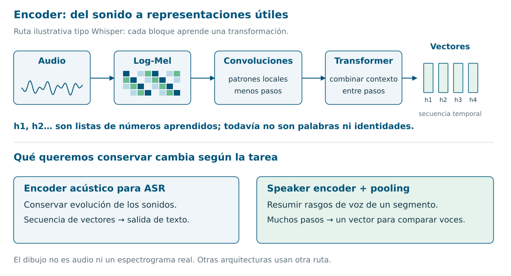

[Versión SVG editable](assets/intuicion/encoders.svg).

Una ruta concreta para imaginarlo es la de **Whisper**: audio → log-Mel → convoluciones → bloques Transformer → secuencia de vectores. Las convoluciones detectan patrones locales y una de ellas reduce la resolución temporal; los bloques Transformer combinan información entre posiciones. La salida todavía no es una transcripción. [Whisper, §2.2](https://arxiv.org/abs/2212.04356).

**Log-Mel** es una representación de cómo cambia la energía por bandas de frecuencia. El encoder transforma esas características en `h1, h2, h3…`: una lista de números por paso. No hay una casilla cuyo significado garantizado sea «la palabra alergia» ni una posición obligatoria por palabra.

**¿Por qué combinar convoluciones y atención?** Las primeras capturan patrones locales; la atención conecta posiciones más lejanas. Conformer combina ambas dentro de sus bloques, además de reducir la secuencia en la entrada. Es otra implementación del encoder, no una cuarta forma de colapsar texto junto a CTC/RNN-T/atención. [Conformer, §2 y figura 1](https://arxiv.org/abs/2005.08100).

#### Encoder acústico frente a speaker encoder

Para ASR interesa conservar la evolución temporal de los sonidos y obtener texto. Para comparar voces interesa resumir rasgos de un **segmento** en un vector. Un speaker encoder suele aplicar **pooling**: agregar muchos pasos acústicos, por ejemplo mediante medias y variación, para producir una representación de longitud fija.

Eso permite comparar segmentos de duraciones diferentes. La diferencia clave es el objetivo de entrenamiento y la salida que necesitamos: **secuencia para reconocer habla; vector por segmento para comparar voces**. No implica que ambas redes eliminen perfectamente toda información ajena a su tarea. [x-vectors, arquitectura y statistics pooling](https://www.danielpovey.com/files/2018_icassp_xvectors.pdf).

### 2. CTC: predecir etiquetas y comprimirlas

**Connectionist Temporal Classification.** En cada paso acústico se predice un token o un símbolo **blank**: «no emitir un token aquí». Blank no significa necesariamente que el paciente esté callado.

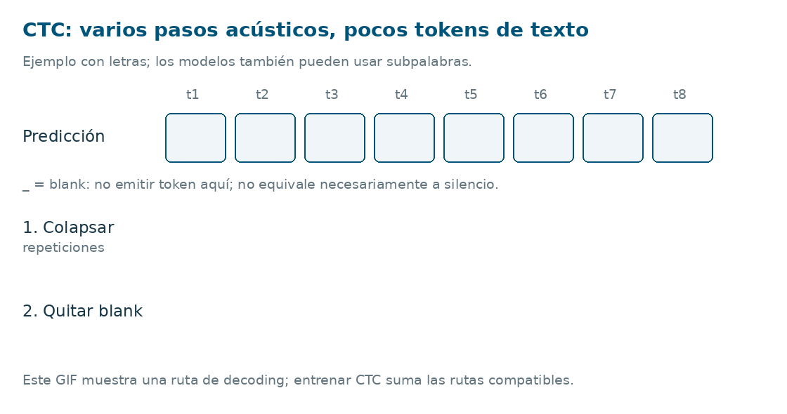

Si tu lector no anima el GIF, abre la [imagen final](assets/intuicion/ctc-poster.png).

El ejemplo usa letras para que se vea:

```text
Una ruta:            t t _ o o _ s s
Colapsar repetidos:   t   _ o   _ s
Quitar blank:        t     o     s
Texto:               tos
```

El orden importa: `l _ l` produce `ll`, porque el blank separa las dos eles. Si eliminas blank antes de colapsar, obtendrías el resultado incorrecto.

El GIF muestra **una ruta de salida**. Durante entrenamiento, CTC suma las probabilidades de todas las rutas compatibles con la transcripción. Así aprende sin fronteras anotadas palabra por palabra. [Graves et al., CTC original, §3–4](https://www.cs.toronto.edu/~graves/icml_2006.pdf).

**Intuición:** el modelo puede dedicar muchos pasos al mismo sonido; luego comprimimos la secuencia de etiquetas. Su salida básica no recibe explícitamente los tokens previamente emitidos. El encoder sí puede aprovechar contexto acústico, y el decoding puede incorporar búsqueda o un modelo de lenguaje. [Jurafsky y Martin, cap. 16, §16.5](https://web.stanford.edu/~jurafsky/slp3/16.pdf).

### 3. RNN-T: avanzar por el audio o añadir texto

**Recurrent Neural Network Transducer.** Tres piezas cooperan:

| Pieza | Qué aporta |
|---|---|
| Encoder | Representación del paso acústico actual. |
| Predictor | Representación del texto que ya se emitió. |
| Joiner, o red conjunta | Combina ambas y calcula probabilidades de salida. |

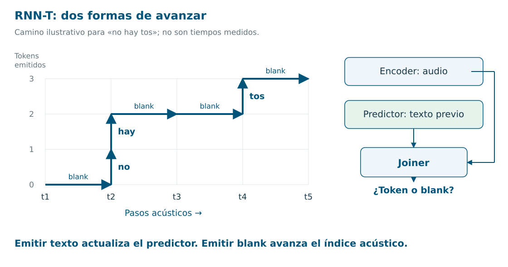

En RNN-T básico hay dos movimientos:

- **Emitir un token:** añadir texto, actualizar el predictor y mantener el índice acústico.
- **Emitir blank:** avanzar un paso acústico, manteniendo el texto previo.

Puede emitir varios tokens en un mismo paso acústico. Por ejemplo, en el dibujo «no» y «hay» salen en `t2`; los pasos no representan necesariamente segundos ni palabras.

**Intuición:** combina «qué estoy oyendo» con «qué llevo escrito». Durante entrenamiento también considera rutas de alineamiento posibles, sin exigir marcas exactas por palabra. [Graves, transducer original](https://arxiv.org/abs/1211.3711).

Permite una producción incremental del texto; el streaming completo depende también de que el encoder pueda trabajar con audio parcial. El nombre RNN-T es histórico: no obliga a que todo el sistema moderno sea una RNN. [Survey de ASR, §II-C](https://arxiv.org/abs/2303.03329).

**¿Sigue usándose?** Sí: [Parakeet TDT v3](https://huggingface.co/nvidia/parakeet-tdt-0.6b-v3) es un transducer moderno. TDT predice también duraciones para saltar pasos acústicos; no es idéntico al RNN-T básico del dibujo. CTC sigue teniendo modelos actuales, como [Parakeet CTC](https://huggingface.co/nvidia/parakeet-ctc-1.1b).

### 4. Atención: escribir consultando el audio

En un encoder–decoder con atención, el encoder representa el audio y el decoder genera texto token a token. Para cada decisión consulta el texto anterior y las representaciones acústicas.

La **atención** calcula cuánto peso dar a distintas representaciones. Por ejemplo, al generar el siguiente token después de «no refiere», el decoder combina información de las posiciones acústicas que le resultan útiles. No es una frontera exacta de palabra ni una explicación clínica de por qué se escribió algo. [Atención para ASR](https://arxiv.org/abs/1506.07503).

En **Whisper**, el decoder es un Transformer: atención al texto previo, atención al audio y capas feed-forward. Hay un encoder de audio separado. **No es simplemente una convolution que transforma audio en una frase.** [Whisper, §2.2 y figura 1](https://arxiv.org/abs/2212.04356).

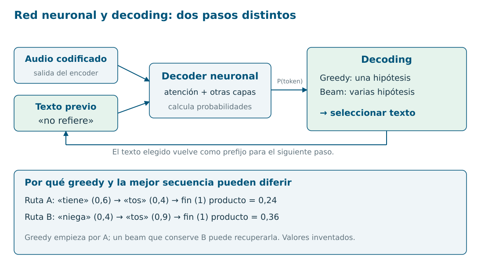

#### Decoder neuronal ≠ algoritmo de decoding

La red produce probabilidades. Después elegimos una secuencia:

- **Greedy:** conservar solo la opción más probable en cada decisión.
- **Beam search:** mantener varias hipótesis parciales y explorar sus continuaciones.

En el ejemplo de la figura, greedy empieza por «tiene», pero la ruta «niega tos» termina con mayor producto de probabilidades. Un beam que conserve esa alternativa puede recuperarla. Es una ilustración de búsqueda; mayor probabilidad del modelo no demuestra mayor corrección clínica.

CTC también tiene decoding, aunque carezca del decoder autoregresivo de Whisper. Tampoco garantiza que elegir la etiqueta más probable en cada frame produzca el texto más probable tras sumar rutas. [CTC, §3.2](https://www.cs.toronto.edu/~graves/icml_2006.pdf).

| Familia | Frase para explicarla oralmente |
|---|---|
| CTC | «Predice etiquetas sobre el audio y luego comprime repeticiones y blanks». |
| RNN-T | «Usa audio y texto previo; decide entre emitir texto y avanzar el audio». |
| Atención | «Genera texto consultando las representaciones del audio y lo ya escrito». |

Estas familias conviven. Las fechas de los papers de la slide no significan que una haya sustituido completamente a la anterior.

### 5. Diarización, rol y sujeto clínico

**Diarizar** es agrupar intervalos de audio por identidad de hablante: «esta voz reaparece aquí». Las etiquetas S1/S2 son arbitrarias; no significan paciente/médico. Los modelos pueden agrupar vectores de voz o predecir directamente actividades simultáneas de hablantes. [Park et al., revisión de diarización](https://arxiv.org/abs/2101.09624).

| Pregunta | Tarea |
|---|---|
| ¿Qué intervalos pertenecen a la misma voz? | Diarización. |
| ¿Esa voz corresponde al médico o al paciente? | Identificación del rol. |
| ¿El síntoma mencionado corresponde al paciente o a su madre? | Atribución clínica del contenido. |

Ejemplo inventado:

```text
S1, paciente:   «No soy alérgico. Mi madre sí, a penicilina».
S2, acompañante: «Yo también soy alérgica a penicilina».
```

Saber quién habla ayuda a separar personas, pero sigue haciendo falta interpretar «mi madre». Una diarización perfecta no basta para rellenar correctamente la alergia del paciente.

Otro caso: el paciente propone suspender un fármaco y el médico decide mantenerlo. Atribuir las intervenciones permite distinguir una petición del plan clínico. Son **casos para incluir en nuestra evaluación**, no cifras publicadas de mejora.

#### Embeddings: poner segmentos parecidos en el mismo grupo

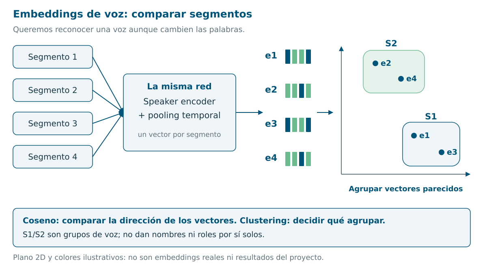

[Versión SVG editable](assets/intuicion/embeddings-voz.svg).

Un **embedding de voz** es una lista de números que sirve para comparar segmentos. Queremos que la voz de una persona resulte parecida a sí misma aunque diga palabras distintas, y que pueda distinguirse de otras voces.

En un entrenamiento típico, la red aprende a distinguir **identidades de hablante** en grabaciones etiquetadas. Después aprovechamos una representación interna para comparar voces nuevas; no necesitamos que pertenezcan a las identidades de entrenamiento. [Snyder et al., x-vectors, §2.3 y §3](https://www.danielpovey.com/files/2018_icassp_xvectors.pdf).

**Coseno** compara la dirección de dos vectores; un valor alto indica parecido según esa representación. **Clustering** decide qué segmentos agrupar a partir de esas similitudes. En la figura, e1/e3 forman S1 y e2/e4 forman S2. El dibujo en dos dimensiones solo explica la agrupación.

TitaNet es un ejemplo de speaker encoder: convoluciones y pooling con atención producen un vector por segmento; después se pueden comparar y agrupar vectores para diarización. [TitaNet, arquitectura y diarización](https://arxiv.org/abs/2110.04410).

El vector **no incluye un nombre o rol garantizado**. Ruido, canal y segmentos breves o mezclados pueden alterar la representación y la agrupación. Un esquema modular necesita resolver también detección de habla, fronteras y solapamiento; «embedding + clustering» describe su idea central, no todos sus pasos. [Revisión de diarización](https://arxiv.org/abs/2101.09624).

#### EEND: predecir directamente actividades de hablantes

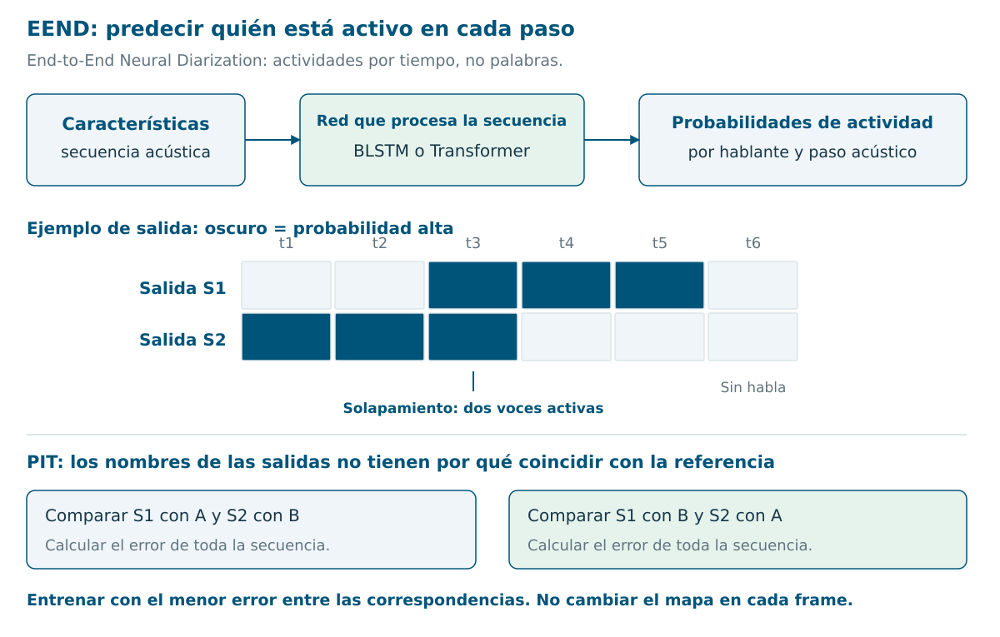

[Versión SVG editable](assets/intuicion/eend.svg).

**End-to-End Neural Diarization** formula la tarea como actividades por tiempo: para cada paso, ¿está activo S1?, ¿está activo S2? Una red recibe características acústicas y devuelve una probabilidad para cada salida.

No necesita una fase separada de extracción de embeddings y clustering. Sí tiene representaciones internas. La clasificación es **multietiqueta**: las salidas de dos hablantes pueden estar activas a la vez, como en `t3` del dibujo. Esa propiedad permite representar solapamiento. [EEND original](https://arxiv.org/abs/1909.05952).

El original usa una BLSTM, que procesa una secuencia hacia delante y atrás. Una variante usa atención Transformer para relacionar posiciones de esa secuencia. «Red temporal» aquí significa que procesa pasos de audio; no implica una sola arquitectura concreta. [EEND con self-attention](https://arxiv.org/abs/1909.06247).

**PIT, permutation-invariant training:** en la referencia llamamos A/B a las voces, pero la red puede asignarlas a sus salidas en orden B/A. Comparamos ambas correspondencias y entrenamos con el menor error. La correspondencia se aplica a **toda la secuencia**, no se intercambia libremente en cada frame. Así penalizamos actividades incorrectas, sin castigar nombres arbitrarios de los canales. Esa comparación usa una loss de actividades —entropía cruzada binaria en el original—; DER es la métrica de evaluación. [Objetivo de EEND, §2.2](https://arxiv.org/abs/1909.05952).

| Ruta | Intuición y decisión pendiente |
|---|---|
| Embeddings + clustering | Comparar segmentos de voz; inspeccionar agrupaciones y sus fallos. Resolver ventanas y solapamientos. |
| EEND | Predecir actividades conjuntamente, incluido solapamiento. El manejo del número de hablantes y la duración depende de la variante. |

Ninguna de las dos identifica automáticamente «médico/paciente» ni convierte el audio en nota. Seguimos evaluando la atribución y el contenido final.

#### Qué evidencia tenemos de que ayuda

[Speaker Role Identification in Clinical Conversations](https://pmc.ncbi.nlm.nih.gov/articles/PMC12952674/) compara señales lingüísticas con/sin identificadores de hablante: reporta **82 % de accuracy/F1 con texto y 95 % incorporando identificadores correctos**, usando segmentación de referencia. Esto demuestra una mejora en identificación de roles, no un aumento del 13 % en calidad final de notas. Los identificadores incorrectos pueden perjudicar.

En [Wang/SCRIBE](https://doi.org/10.1038/s41746-025-01622-1), distorsionar roles produce poco cambio en sus métricas automáticas de nota, salvo BERT F1. Una consulta de dos participantes puede aportar pistas lingüísticas suficientes; con acompañantes o respuestas ambiguas, el riesgo de atribución cambia. Nuestra hipótesis debe comprobarse en esos casos, conservando el mismo texto/generador y variando la atribución.

### 6. WER, DER, cpWER y tcpWER

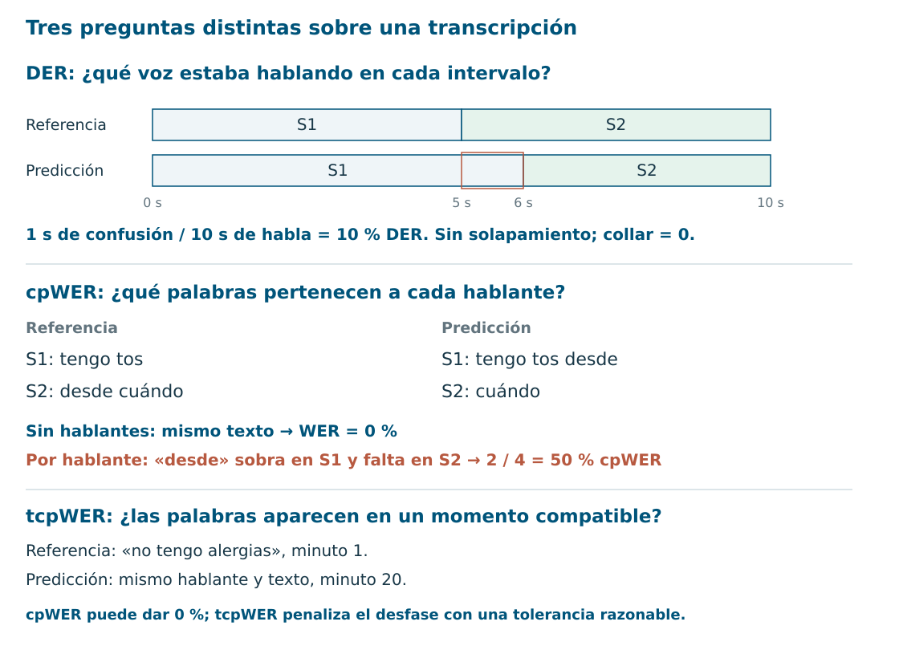

#### WER: errores de palabras

**Word Error Rate = (sustituciones + eliminaciones + inserciones) / palabras de referencia.** Se busca un alineamiento que minimice las operaciones necesarias.

```text
Referencia:  no tengo fiebre
Predicción:  sí tengo fiebre
             ↑ una sustitución
WER = 1 / 3 = 33,3 %
```

La palabra «no» pesa igual que cualquier otra. WER no dice cuánto daño clínico causó el error; por eso necesitamos análisis específico de negaciones, dosis, entidades y nota final. [Jurafsky y Martin, cap. 16, §16.6](https://web.stanford.edu/~jurafsky/slp3/16.pdf).

#### DER: errores de tiempo de hablante

**Diarization Error Rate = (habla omitida + falsa alarma + confusión de hablante) / tiempo de habla de referencia.** Se expresa como proporción de tiempo; no cuenta palabras.

En la figura, el cambio de S1 a S2 debía ocurrir en el segundo 5 y se predice en el 6. Es un segundo mal atribuido entre diez: **10 % DER**.

Hay que declarar si se evalúa solapamiento, qué zonas se puntúan y qué **collar** se excluye alrededor de las fronteras anotadas. Aquí usamos collar cero y ningún solapamiento. Con dos personas hablando a la vez, el denominador puede incluir ambos tiempos de hablante, no solo segundos de reloj. [Implementación de referencia dscore](https://github.com/nryant/dscore).

#### cpWER: texto correcto en el hablante correcto

**Concatenated minimum-Permutation Word Error Rate.** Concatenar el texto de cada hablante, probar el mejor emparejamiento entre etiquetas y calcular errores de palabras por hablante.

En la figura, «desde» se mueve de S2 a S1. Sin hablantes, ambas secuencias dicen «tengo tos desde cuándo»: **WER 0 %**. Por hablante, hay una inserción y una eliminación: **cpWER 2/4 = 50 %**.

La permutación evita penalizar un cambio arbitrario de nombres. Si intercambiamos S1 y S2 en toda la predicción, pero sus intervenciones siguen bien agrupadas, cpWER puede seguir en cero. No demuestra que el sistema haya identificado quién es el médico. [MeetEval, definición e implementación](https://github.com/fgnt/meeteval).

#### tcpWER: añadir compatibilidad temporal

**Time-Constrained minimum-Permutation Word Error Rate.** Añade restricciones temporales al alineamiento: una palabra no puede emparejarse con otra arbitrariamente lejana.

Si «no tengo alergias» se dice en el minuto 1, pero aparece predicho en el minuto 20 con el mismo hablante, cpWER puede dar cero. tcpWER penaliza ese desfase si queda fuera de la tolerancia elegida. Sigue siendo error de palabras; no es el promedio del error en segundos.

Necesita tiempos de palabras o aproximaciones desde los segmentos. Hay que declarar el método y el collar temporal; este collar permite tolerancia en el emparejamiento, **a diferencia del collar de DER que excluye zonas alrededor de fronteras**. [Documentación oficial de tcpWER](https://github.com/fgnt/meeteval/blob/main/doc/tcpwer.md); [paper de MeetEval](https://arxiv.org/abs/2307.11394).

### 7. p50 y p95: cuánto espera el usuario

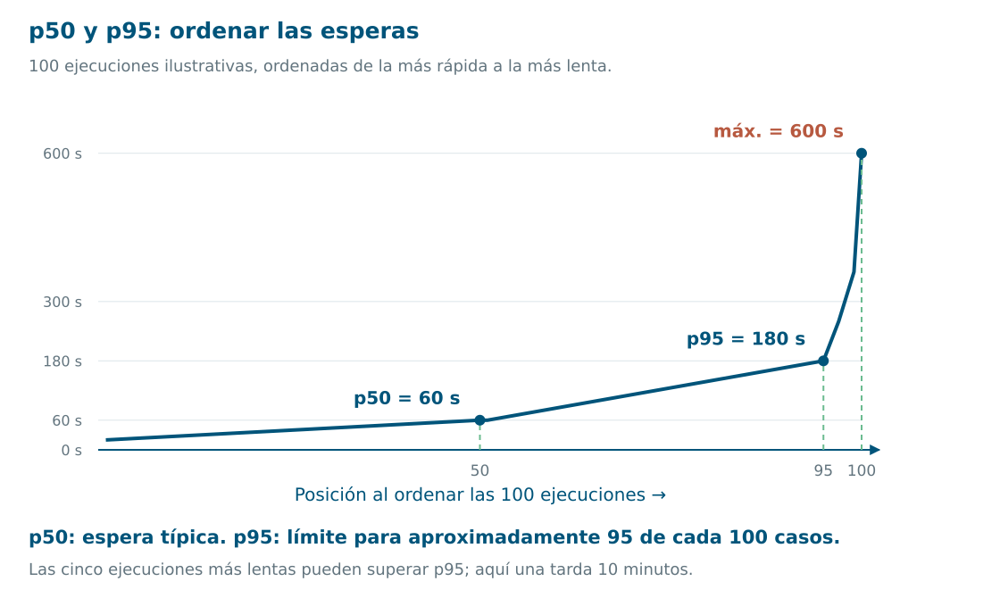

**Ordena las latencias de menor a mayor.** El percentil indica una posición de esa distribución:

| Medida | Interpretación del ejemplo |
|---|---|
| p50 = 60 s | Aproximadamente la mitad de los casos tarda como máximo un minuto. Es la mediana: la espera típica. |
| p95 = 180 s | Aproximadamente el 95 % tarda como máximo tres minutos. Queda una cola más lenta. |
| Máximo = 600 s | El caso más lento observado tardó diez minutos. |

p95 **no es el máximo**, ni «el modelo tiene 95 % de precisión», ni «el 95 % tarda exactamente eso». Aquí se usa posición ordenada, o *nearest rank*. Otros métodos interpolan entre valores; pequeñas muestras y distintas convenciones pueden dar números diferentes. [NIST, percentiles](https://www.itl.nist.gov/div898/handbook/prc/section2/prc262.htm).

Para el escriba habría que especificar desde cuándo hasta cuándo medimos: por ejemplo, **desde que termina la consulta hasta que se presenta el borrador**. También importa separar arranque frío, duración de consultas, hardware y concurrencia. No compararía p95 de audios de un minuto con p95 de consultas de media hora.

Un ratio útil es **RTF, real-time factor = tiempo de procesamiento / duración del audio**. Procesar veinte minutos de audio en cinco minutos da RTF 0,25, o cuatro veces más rápido que tiempo real. Eso no demuestra que el sistema pueda escuchar en streaming con cinco segundos de retraso: el procesamiento por archivo y la latencia incremental son propiedades distintas.

### 8. Cinco comprobaciones rápidas

1. `l l _ l` en CTC produce ¿`l` o `ll`? **`ll`: colapsar primero y quitar blank después.**
2. ¿RNN-T puede emitir dos tokens en un paso acústico? **Sí; actualizar el texto no obliga a avanzar el audio.**
3. ¿Una convolution es «el decoder»? **Depende del modelo; en Whisper el decoder es un Transformer.**
4. ¿WER cero demuestra buena atribución? **No; el ejemplo tiene cpWER 50 %.**
5. ¿p95 de tres minutos significa que nadie espera más? **No; aproximadamente el 5 % puede superar ese tiempo.**

Los [visuales y su script](assets/intuicion/generar_visuales.py) son propios. El GIF usa Pillow; no se necesita Manim. Los enlaces a fuentes están junto a las explicaciones, y las ilustraciones no reproducen figuras de terceros.

## De la consulta a la nota

### 1. Qué hace cada pieza

| Pieza | Pregunta que resuelve | Qué devuelve |
|---|---|---|
| **Generador** | ¿Cómo documento este encuentro? | Un borrador de nota. |
| **Retriever / recuperador** | ¿Qué fragmentos de la historia hacen falta aquí? | Registros seleccionados con paciente, fecha y procedencia. |
| **Extractor de hechos** | ¿Qué afirmaciones aparecen en estas entradas? | Hechos con sujeto, negación, momento y fuente. |
| **Verificador** | ¿Esta afirmación del borrador tiene respaldo en las fuentes disponibles? | Un veredicto y su evidencia. |
| **LLM juez** | ¿Qué calidad tiene este resultado según estos criterios? | Puntuaciones, decisiones o comentarios. |
| **Rúbrica** | ¿Qué significa hacerlo bien o mal? | Criterios y ejemplos de puntuación. Es una instrucción, no un modelo. |
| **Nota gold** | ¿Qué documento usamos como referencia en este caso? | Una nota revisada por clínicos; no la única redacción válida. |

Un verificador puede implementarse con un LLM juez. Y generador y juez pueden usar el mismo modelo con instrucciones diferentes. Lo que distingue sus funciones es **qué información reciben y qué decisión toman**, no el nombre del modelo.

### 2. Generar directamente o escribir primero los hechos

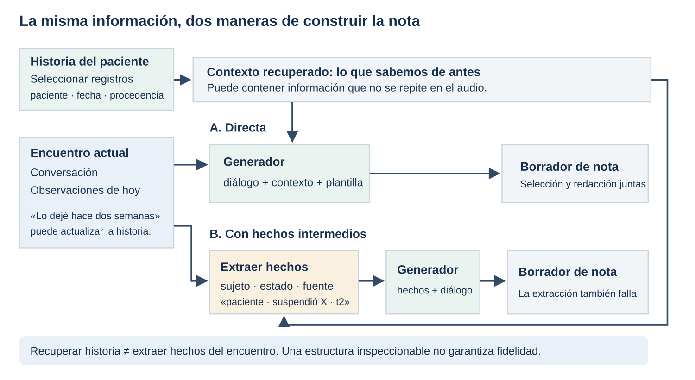

La ruta directa manda al modelo el diálogo, el contexto disponible y una plantilla. El modelo selecciona y escribe en la misma generación. Es un buen baseline: pocas piezas y pocos puntos donde perder información.

La segunda ruta hace explícito un paso intermedio. Primero obtiene algo como `paciente · niega fiebre · hoy · turno 4`; después convierte los hechos seleccionados en la nota. Podemos hacerlo en dos llamadas o pedir hechos y nota dentro de una misma secuencia. Conservar el diálogo original permite que la segunda fase vuelva a consultar información que el extractor se haya saltado.

El posible beneficio es poder inspeccionar **qué se seleccionó y de dónde salió**. El coste es otro paso que puede omitir, atribuir mal o deformar un hecho. Una lista de hechos puede parecer ordenada y estar equivocada. La mejora respecto a generación directa hay que medirla.

El antecedente de **Nuance/Singh** genera un prefijo *Chain-of-Clinical-Facts* antes de la nota. Durante entrenamiento, los hechos se extraen de las notas de referencia; durante inferencia, se predicen desde la conversación. Esto es planificación de la generación, no recuperar la historia del paciente. [Singh et al., §3.1.2](https://aclanthology.org/2023.clinicalnlp-1.18/).

#### Historia recuperada y hechos del encuentro son entradas distintas

Si el médico dice «mantenemos el tratamiento habitual», el diálogo puede no contener el nombre del medicamento. La historia podría aportarlo. Recuperar esa historia significa seleccionar un registro externo; extraer hechos del diálogo significa representar lo que se acaba de decir.

Para una historia pequeña puede bastar una consulta estructurada o una selección fija. Para una historia extensa podemos buscar fragmentos y pasarlos al generador: esa es la idea de RAG. Antes de buscar por similitud, hay que limitar **paciente, episodio y fecha**. Una mención muy parecida del paciente incorrecto no sirve.

La historia tampoco debe borrar una actualización del encuentro: «tratamiento activo» hace un mes y «lo dejé hace dos semanas» hoy constituyen un cambio documentado o una discrepancia que conservar.

**¿Mejora la nota? Es una pregunta abierta para nuestro caso.** Nuance y ASCRIBE comparan formas de organizar hechos del diálogo; no añaden una historia independiente. Zuckerman compara una pipeline ambient con otra que además recupera historia, selecciona y reescribe: no aísla el efecto del contexto. ACI-Bench/PriMock no incluyen el benchmark longitudinal que necesitaríamos. La [ficha de evidencia](evidencia-contexto-notas.md) explica esos controles y propone comparar el mismo generador sin historia, con selección manual y con retrieval automático.

### 2.1. ¿Y si un audio LLM hace varias tareas a la vez?

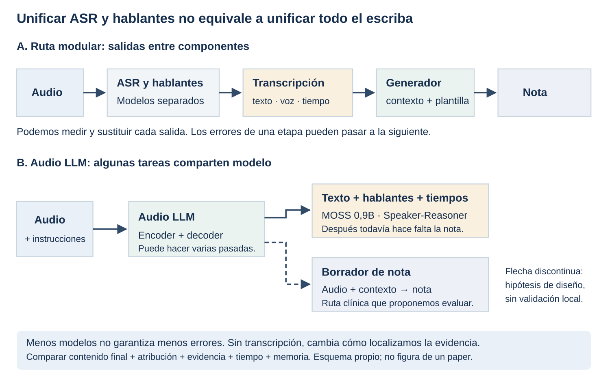

**Una tarea no exige siempre un modelo independiente.** Podemos usar ASR, diarización y generador separados, o un modelo que produzca texto, hablantes y tiempos conjuntamente. También podemos investigar audio + contexto → nota sin pasar toda la información por una transcripción obligatoria. Son grados distintos de unificación: juntar ASR y hablantes todavía no equivale a tener un escriba completo.

| Ejemplo | Qué unifica o admite | Qué podemos afirmar |
|---|---|---|
| **MOSS-Transcribe-Diarize 0,9B** | Audio → texto, tiempos y etiquetas anónimas de hablante | La unificación de ASR y hablantes también existe en modelos pequeños. Su tarea publicada es transcribir, no escribir una nota clínica. [Ficha oficial](https://huggingface.co/OpenMOSS-Team/MOSS-Transcribe-Diarize). |
| **Speaker-Reasoner, checkpoint 32B** | Audio → texto, hablantes, tiempos y género inferido, con procesamiento iterativo | Especializado en transcripción atribuida. Etiquetar una voz como S1 no identifica a un médico ni a una persona real. [Checkpoint](https://huggingface.co/ASLP-lab/Speaker-Reasoner), [paper](https://arxiv.org/abs/2604.03074). |
| **Qwen3-Omni-30B-A3B** | Recibe audio/texto y genera respuestas; modelo multimodal MoE | Permite plantear instrucciones sobre audio. Su ficha no demuestra calidad de notas clínicas españolas ni atribución fiable en nuestro dominio. [Ficha oficial](https://huggingface.co/Qwen/Qwen3-Omni-30B-A3B-Instruct). |

En Speaker-Reasoner, «un modelo» no significa «una pasada». Primero hace un inventario global de hablantes; luego propone límites temporales, consulta recortes y continúa hasta consolidar la transcripción. Su caché conserva ejemplos previos de **etiqueta + audio + texto** para mantener coherencia entre fragmentos. Es contexto acústico por hablante, distinto de la KV cache interna que acelera generación. El paper inicial evalúa reuniones en mandarín; estas pruebas no validan nuestro español médico ni una nota SOAP. [Método, §§2.1–2.3](https://arxiv.org/html/2604.03074v1#S2).

Como ejemplo inventado de ese mecanismo: «hay dos voces» → analizar segundos 0–12 → emitir `S1: tengo tos` → conservar ese fragmento como referencia de S1 → analizar el siguiente tramo. La secuencia de decisiones es una estrategia de inferencia; no demuestra razonamiento clínico. Además, en las grabaciones largas sin segmentación, Speaker-Reasoner queda por detrás de Gemini en las métricas publicadas: la ventaja depende del protocolo. [Paper, tabla 2](https://arxiv.org/html/2604.03074v1#S3.T2).

En Qwen, **A3B** expresa unos 3B parámetros activos por token dentro de una arquitectura de mayor tamaño. No significa que todos los pesos que debemos alojar sean 3B. Ni el tamaño del checkpoint ni hacer varias tareas juntas determinan por sí solos la RAM o la latencia. [Qwen3-Omni, informe técnico](https://arxiv.org/abs/2509.17765).

La ruta audio → nota evita que una transcripción textual sea la única entrada acústica del generador, pero puede perder información al seleccionar hechos o al producir la propia nota. Si no emitimos transcripción, tenemos menos salidas intermedias para localizar fallos; aún podemos evaluar con audio y referencias externas. La comparación útil es **misma consulta, contenido final, atribución, evidencia recuperable, tiempo y memoria**. Producir también hechos con fuente o una transcripción es una opción de diseño que habría que probar; no garantiza eliminar errores.

### 3. Un ejemplo de principio a fin

**Entradas disponibles:**

```text
HCIS, hace un mes: enalapril registrado como tratamiento activo.
Paciente, turno 1: «Tengo tos desde hace tres días, pero fiebre no».
Paciente, turno 2: «Dejé el enalapril hace dos semanas».
Paciente, turno 3: «Con amoxicilina me salió una erupción».
Médico, turno 4: «Revisaremos el tratamiento. Vuelve en 48 horas».
Observación manual de hoy: temperatura 36,8 °C.
No se aporta una descripción de auscultación ni una valoración diagnóstica.
```

**Hechos que querríamos conservar:**

| Hecho | Atributo que cambia su significado | Fuente |
|---|---|---|
| Tos de tres días | Síntoma referido por el paciente | Turno 1 |
| Niega fiebre | Negación; no equivale a una medición | Turno 1 |
| Suspendió enalapril hace dos semanas | Estado actual referido, distinto del registro anterior | Turno 2 + HCIS |
| Refiere erupción con amoxicilina | Antecedente referido; no inventar mecanismo ni gravedad | Turno 3 |
| Temperatura 36,8 °C | Dato observado hoy | Entrada manual |
| Revisar tratamiento y volver en 48 h | Plan expresado por el médico | Turno 4 |

Una nota posible —en un producto real, adaptaríamos la plantilla con médicos— sería:

```text
S: Tos de tres días. Niega fiebre. Refiere suspensión de enalapril hace
dos semanas y antecedente de erupción con amoxicilina.
O: Temperatura 36,8 °C, según registro de hoy.
A: No se aporta valoración diagnóstica en las entradas disponibles.
P: Revisar tratamiento y realizar nueva valoración en 48 horas.
```

Ahora imaginemos un borrador erróneo:

```text
Tos de tres días con fiebre. Auscultación normal. Continúa enalapril.
Nueva valoración en 48 horas.
```

Un verificador por afirmaciones podría devolver:

| Afirmación escrita | Comprobación | Resultado |
|---|---|---|
| Tos de tres días | Coincide con turno 1 | Respaldada |
| Tiene fiebre | Turno 1 la niega | Contradicción |
| Auscultación normal | No aparece en ninguna entrada | Evidencia insuficiente |
| Continúa enalapril | El registro previo no incorpora la suspensión comunicada hoy | Conflicto de estado/fecha; revisar |
| Nueva valoración en 48 h | Coincide con turno 4 | Respaldada |

**La erupción con amoxicilina no aparece en el borrador.** Un verificador que recorre solo lo escrito nunca encontrará esa omisión. Hace falta otra dirección de comprobación: desde los hechos que deberían documentarse hacia la nota.

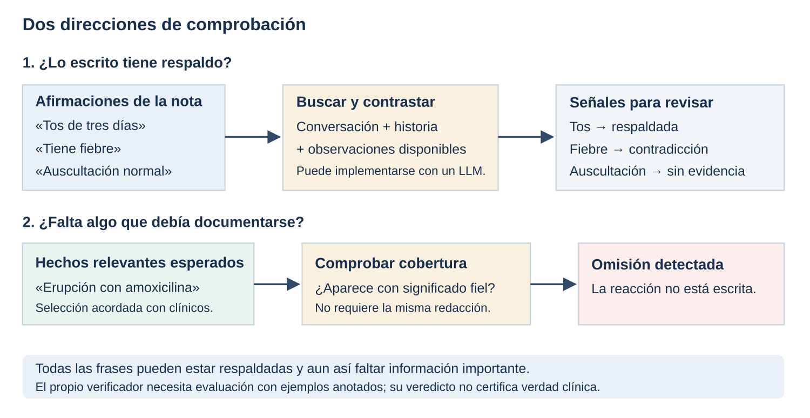

Podemos medir por separado `afirmaciones respaldadas / afirmaciones escritas` y `hechos relevantes conservados / hechos relevantes esperados`. Son ejemplos de métricas para nuestro protocolo: hace falta acordar qué es un hecho, cómo se empareja y qué relevancia le asignan los clínicos. No equivalen automáticamente a LINK/CORRECT de otro paper.

### 4. Verificar en uso y evaluar al verificador

En uso no tenemos una nota perfecta para cada paciente. Podemos comparar el borrador con conversación y contexto, recuperar evidencia y pedir un veredicto. **Tener fuentes permite ejecutar el chequeo; no demuestra que el chequeo acierte.**

Para evaluar al verificador, clínicos anotan una muestra con las mismas fuentes. Comparamos sus etiquetas con las del sistema: ¿qué errores detectó?, ¿cuáles dejó pasar?, ¿cuántas alertas eran falsas? Hay que mirar cada categoría, además de accuracy: un sistema que aprueba casi todo puede acertar mucho si la muestra contiene pocas notas incorrectas y fallar en los errores que importan.

**VeriFact** aplica recuperación de evidencia del EHR y un juez LLM a afirmaciones descompuestas del texto. Usa las etiquetas *Supported*, *Not Supported* y *Not Addressed*: la segunda incluye respaldo parcial y contradicción, y la tercera indica que la historia no trata ese dato. Su dataset contiene **100 pacientes y 13.290 proposiciones**, anotadas por tres clínicos por proposición. Estudia resúmenes hospitalarios, no nuestro escriba de consulta. [VeriFact](https://arxiv.org/abs/2501.16672), [método y etiquetas](https://arxiv.org/html/2501.16672v1#S2).

Nuestro dibujo de «respaldada / contradicción / evidencia insuficiente» es una simplificación pedagógica. Un registro ausente puede ser una alucinación o información nueva que el médico conoce: no significa automáticamente falsedad.

**Respaldo es distinto de verdad sobre el paciente.** Si ASR transcribe «tengo fiebre» cuando se dijo «no tengo fiebre», el generador y el verificador pueden coincidir perfectamente sobre la transcripción equivocada. Auditar el audio y conservar enlaces temporales ayuda a localizar ese fallo.

### 5. SCRIBE: cómo combinan métricas, médicos y jueces

**SCRIBE es un marco de evaluación**, demostrado sobre un escriba propio. Wang et al. estudian **40 grabaciones de consultas prenatales**, de 6–35 minutos, con media de 16,7 minutos. Transcriben con Whisper; atribuyen hablantes sobre texto con GPT-4o; generan SOAP con GPT-4o y comparan con LLaMA 3.1 8B. Eso explica por qué su «diarización» no es idéntica a un diarizador acústico de voces. [Artículo](https://doi.org/10.1038/s41746-025-01622-1), Methods; revisado también en la copia de Zotero del proyecto.

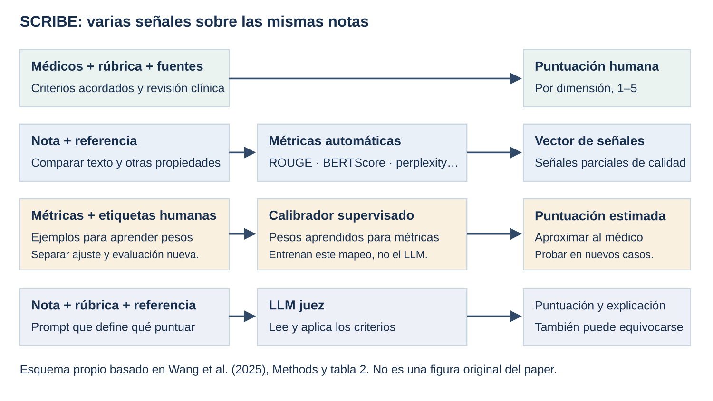

#### A. Revisión clínica: el criterio que queremos aproximar

Dos médicos puntúan independientemente las 40 notas con una rúbrica de 1 a 5. Cada uno corrige 20 notas para construir las 40 referencias. Promedian puntuaciones; los desacuerdos se revisan con apoyo de un tercer clínico. El acuerdo entre los dos evaluadores ronda el **53,8 %**, así que la etiqueta humana tampoco es completamente estable.

La rúbrica separa lenguaje —fluidez, coherencia, claridad, brevedad y estructura—, contenido —relevancia, completitud, factualidad y comprensión— y confianza —prudencia y toxicidad—. Una nota puede sonar excelente y conservar mal un tratamiento. Esa es la razón de evaluar dimensiones por separado. [Wang et al., Human assessment](https://doi.org/10.1038/s41746-025-01622-1).

#### B. Métricas automáticas: señales reproducibles de partes de la calidad

| Señal usada o propuesta en SCRIBE | Intuición | Límite |
|---|---|---|
| WER | Cuántas palabras cambiaron respecto a una transcripción corregida | No pondera daño clínico. |
| ROUGE / BLEU / METEOR | Coincidencia de palabras y secuencias con la referencia; METEOR añade emparejamiento más flexible | Una paráfrasis válida puede puntuar peor; una negación cambia poco texto. |
| BERTScore | Coincidencia mediante representaciones contextuales de tokens | Parecido semántico no prueba fidelidad clínica. |
| Perplexity con GPT-2 | Cuán probable parece el texto a ese modelo de lenguaje | Texto falso puede ser muy probable y fluido. No está acotada a 0–1. |
| Lecturabilidad, compresión y estructura | Facilidad de lectura, longitud relativa y organización | Proxies; más corto no equivale a mejor. |
| Toxic-BERT | Señales de lenguaje ofensivo | No es una medida general de seguridad clínica. |

La tabla 2 organiza las señales por criterio; Methods describe las métricas empleadas. Conviene distinguir el repertorio del marco de las métricas cuyos resultados se presentan. Ninguna puntuación aislada resuelve la calidad de la nota. [Wang et al., tabla 2 y Auto evaluation](https://doi.org/10.1038/s41746-025-01622-1).

**LINK/CORRECT añaden un LLM dentro de una métrica por hechos.** Extraen información de referencias, transcripciones y notas generadas; LINK comprueba qué hechos aparecen en la referencia y en la nota, y CORRECT si conservan significado y contexto. Lo implementan con GPT-4o, adaptando el procedimiento de Sezgin. Para intuirlo: «¿está el dato?» y «¿está bien expresado?». Eso ya puede fallar en la extracción o en el emparejamiento, aunque el resultado final sea un porcentaje. [Wang et al., Auto evaluation](https://doi.org/10.1038/s41746-025-01622-1).

#### C. Trained auto evaluation: aprender cómo combinar métricas

Aquí **entrenan una combinación de métricas**, no el generador ni el juez GPT. La tabla 2 especifica regresión supervisada: las entradas son puntuaciones automáticas y la salida que se intenta aproximar es la puntuación humana.

```text
Nota → [ROUGE, BERTScore, perplexity, ...] → combinación aprendida
                                                    ↓
                                          puntuación humana estimada

Para aprender esa combinación necesitas notas puntuadas por médicos.
```

La regresión ajusta pesos para reducir la diferencia entre lo que predice la combinación y las puntuaciones clínicas de los ejemplos de ajuste. Dos notas con ROUGE parecido pueden recibir notas clínicas distintas; combinar señales puede acercarse más al criterio de los médicos. El artículo informa mayor correlación tras calibrar —por ejemplo, **claridad 0,69**—, frente a correlaciones de métricas crudas entre −0,16 y 0,28. **No encuentro descrito un test independiente de la calibración que permita leer esos números como generalización a casos nuevos.** No debemos inventar split, loss o arquitectura más concretos que lo publicado. [Wang et al., tabla 2, Trained auto evaluation y Discussion](https://doi.org/10.1038/s41746-025-01622-1).

Para nuestro proyecto: acordar rúbrica, recoger puntuaciones, ajustar en un subconjunto y comprobar en encuentros/pacientes separados. Esto último es el diseño que proponemos, no un resultado nuestro.

#### D. LLM juez: pasar la rúbrica al modelo

Le dan a GPT-4o la nota que se evalúa, criterios y texto de referencia. El modelo asigna puntuaciones y explica sus deducciones. El suplemento compara dos referencias: **transcripción completa** frente a **nota gold**. No describe fine-tuning del juez; es evaluación mediante prompting, con temperatura 0,7. [Suplemento, Additional Information on Methods, pp. 25–26](https://media.springernature.com/original/springer-static/esm/art%3A10.1038%2Fs41746-025-01622-1/MediaObjects/41746_2025_1622_MOESM1_ESM.pdf).

La primera referencia pregunta fidelidad al encuentro; la segunda aproxima la nota que se esperaba. Si la gold omitió algo importante, la comparación también puede heredarlo. Si la referencia contiene información que nunca se proporcionó al generador, podemos penalizar al generador por un dato que no podía conocer.

El juez global se parece a un médico rellenando una ficha; el verificador por afirmaciones se parece a revisar el respaldo de cada frase. Podemos combinar ambos, pero una valoración global alta no certifica cada afirmación.

#### Qué límites hay que recordar

La muestra de SCRIBE es pequeña y de una especialidad; los datos reales no son públicos. El juez usa la misma familia de modelos que uno de los generadores, y algunas gold parten de notas GPT corregidas: los autores reconocen posible sesgo favorable. Regenerar notas cinco veces no elimina ese parentesco entre referencia y generación. [Wang et al., Discussion y Auto evaluation](https://doi.org/10.1038/s41746-025-01622-1).

Un ejemplo útil de cautela: el suplemento muestra que pasar de escala 1–5 a 1–3 aumenta el acuerdo medio juez–humano de **57,3 % a 85,7 %**, pero reduce la correlación media de Spearman de **0,15 a 0,08**. Agrupar puntuaciones hace más fácil coincidir; no necesariamente mejora la discriminación entre notas. [Suplemento, tabla 3](https://media.springernature.com/original/springer-static/esm/art%3A10.1038%2Fs41746-025-01622-1/MediaObjects/41746_2025_1622_MOESM1_ESM.pdf).

### 6. Aplicarlo a nuestro ejemplo

Podemos diseñar una rúbrica sencilla: **fidelidad** —niega fiebre, suspensión bien representada—; **completitud** —conserva reacción referida y plan—; **procedencia** —distingue medicación previa y actualización—; **uso práctico** —cuánto tarda el médico en corregirlo—.

Una métrica de parecido podría dar un resultado razonable al borrador erróneo porque contiene «tos», «enalapril» y «48 horas». Un juez con la conversación debería deducir puntos y citar por qué. Un verificador debería señalar fiebre, auscultación y tratamiento. La revisión de cobertura debería detectar la erupción omitida. **No son cuatro votos equivalentes: cada método observa una parte del problema.**

Lo defendible hoy es proponer una comparación con mismos casos y rúbrica, revisar errores con médicos y comprobar si el juez reproduce sus decisiones en casos separados. Sigue siendo hipótesis que los hechos intermedios mejoren nuestra nota, que el recuperador elija siempre el contexto correcto o que un juez calibrado en un idioma funcione igual en español.

Para comprobar que lo tienes: si una nota solo dice «tos de tres días», ¿puede tener todas sus frases respaldadas y seguir siendo mala? Sí: en este ejemplo faltan negación de fiebre, actualización de tratamiento, reacción referida, temperatura y plan. **Factualidad y completitud son preguntas distintas.**

Las figuras de esta ficha son esquemas originales del proyecto, no figuras de los papers. El detalle de métodos y resultados de Robust SOAP, KOSMOS y ASCRIBE está en [intuicion-papers.md](intuicion-papers.md).

## Qué hace cada paper

Primero ubica qué pregunta responde cada trabajo:

| Trabajo | Pregunta principal | Qué hace explícito |
|---|---|---|
| **Robust SOAP** | ¿La nota conserva los hechos y qué pasa si alteramos la transcripción? | Comparación con referencia y comprobación de hechos contra la conversación. |
| **KOSMOS** | ¿Ayuda estructurar la consulta antes de redactar? | Entidades, atributos, relaciones y fuentes. |
| **ASCRIBE** | ¿Cómo seleccionar información clínicamente relevante y entrenar ese comportamiento? | Hechos, evidencia, relevancia y señales de entrenamiento. |
| **Nuance / Chain-of-Clinical-Facts** | ¿Ayuda generar un plan de hechos antes del texto? | Un prefijo de hechos generado por el mismo decoder. |

**SCRIBE y ASCRIBE son trabajos distintos.** SCRIBE es el marco de evaluación de Wang et al. que mostramos en la presentación. ASCRIBE es el trabajo en **tailandés**, no vietnamita, explicado aquí. Robust SOAP también propone evaluación, pero con otro protocolo.

### 1. Robust SOAP: la referencia no contiene necesariamente toda la información

**Idea que recordar:** si una frase no aparece en la nota de referencia, todavía no sabemos si está inventada. Hay que volver a la conversación.


**El protocolo del paper.** Parten de **51 consultas** de PriMock57 tras depurar referencias. Un LLM genera SOAP desde texto. Extraen hechos atómicos de nota generada, nota gold y transcripción, organizados con QNOTE y fragmento de fuente. Comparan hechos generados con gold para medir cobertura, omisión y contradicción; los que no figuran en gold se contrastan después con la conversación. Si tienen soporte, son elaboraciones válidas; si no, contenido sin respaldo.

Para robustez, introducen **un error textual por caso** y comparan las notas obtenidas con entrada original y alterada: analizan **44 errores inducidos**. No entrenan un generador nuevo ni ejecutan ASR o diarización. Aproximadamente **92 %** del contenido inicialmente ausente del gold resulta respaldado por el diálogo. La evaluación depende de LLM; perturbar texto aisladamente no reproduce todas las dificultades del audio real. [Latif et al., 2026: §§4–5 y figura 1](https://proceedings.mlr.press/v333/latif26a.html).


*Figura original recortada sin modificar: Latif et al., CHIL 2026, PMLR 333, p. 452. Copyright de los autores. Es distinta de la figura de SCRIBE utilizada en las diapositivas.*

#### Un ejemplo para recorrer las dos fases

Supongamos estas tres entradas:

```text
Conversación: «Tos desde hace tres días. No he tenido fiebre».
Gold:        «Tos de tres días».
Generada:    «Tos de tres días, sin fiebre».
```

En la primera comparación, «sin fiebre» parece un añadido porque falta en gold. En la segunda, aparece su evidencia. Penalizarlo como alucinación sería un fallo del evaluador. En cambio, «auscultación normal» carece de soporte si no hay exploración documentada.

Otra cuestión es **qué debía entrar en la nota**. Una frase puede estar respaldada y ser irrelevante para el objetivo. Fidelidad, cobertura y utilidad clínica son preguntas relacionadas, pero distintas.

#### Qué podríamos copiar

Primero generar desde transcripción revisada; después alterar una negación, dosis o sujeto manteniendo el resto constante. Comparar los hechos finales y pedir a clínicos que auditen una muestra del evaluador. Así sabemos qué cambio desencadena el error.

Una segunda etapa usaría el audio y ASR reales. Allí los errores pueden aparecer juntos y afectar también a turnos y atribución. Ese experimento ampliaría el del paper: todavía tendríamos que construirlo.

**Leer primero:** figura 1 → §4.1.3, las dos fases → §5.1.2, perturbaciones. La [ficha existente](robust-soap.md) aclara cómo leer sus tablas y sus límites.

**Comprueba si lo captaste:** ¿puede una nota tener alta cobertura del gold y, aun así, incluir información inventada? Sí: cubrir los hechos esperados no elimina las adiciones sin soporte.

### 2. KOSMOS: estructurar lo que ya está en la consulta

**Idea que recordar:** construir una ficha organizada de la conversación antes de pedir la nota. Un grafo añade relaciones a esa ficha.


#### Cómo viaja la información

El código divide y contextualiza turnos, extrae menciones y las agrupa como entidades; conserva atributos y procedencia. Usa UMLS para normalizar conceptos y construye relaciones entre nodos. El generador recibe **grafo solo**, **transcripción + nodos**, o **transcripción + grafo**. El repositorio conserva artefactos intermedios para inspección. Esta búsqueda en terminologías es diferente de recuperar historia de un paciente. [Repositorio y flujo de KOSMOS](https://github.com/ryanwaynehenry/KOSMOS), [pipeline publicada](https://github.com/ryanwaynehenry/KOSMOS/blob/main/src/clinical_kg/pipeline.py).

Ejemplo propio: «Antes tomaba 500; desde hoy serán 1000 al día». La tarea incluye resolver **500 de qué**, quién toma el fármaco y cuándo cambia la pauta. Si extraemos dos cantidades sin sus relaciones, podemos escribir una dosis incorrecta aunque los números estén bien reconocidos.

Piensa en tres niveles:

- **Mención:** una expresión encontrada, como «500 mg» en T4.
- **Nodo con atributos:** el régimen previo de ese medicamento, con dosis y fuente.
- **Relación:** quién usa ese régimen o quién prescribe el nuevo.

Normalizar «falta de aire» a un concepto estable puede ayudar a organizar términos. Pero un código no demuestra el diagnóstico: una normalización demasiado específica añade información que el diálogo quizá no respalda.

#### Qué entrenan y cómo lo evalúan

El estudio usa GPT-5.2 en sus etapas LLM; no presenta un nuevo entrenamiento supervisado de esa pipeline. Compara variantes sobre los tres tests de ACI-BENCH mediante métricas de nota, hechos y citas. Las mejores variantes conservan la transcripción. Las mejoras de recall por hechos frente al baseline fuerte son **modestas y no significativas**; hay mejora de citas. No miden independientemente la extracción ni demuestran ahorro de revisión en una consulta real. [Henry y Gong, 2026: §§2–4 y limitaciones](https://doi.org/10.3390/info17040355).

#### Qué podríamos copiar

Empezaría con **hecho + atributos + fuente**, conservando el texto original. Compararía esa lista con transcripción sola. Solo añadiría relaciones si resuelven errores observables, como mezclar antecedentes familiares con problemas del paciente. El resultado de KOSMOS no permite dar por hecho que un grafo completo supera una lista más sencilla.

**Leer primero:** §2.1 y figuras 2–3 para el flujo; §2.6 para atributos; discusión de nodos frente a relaciones; limitaciones. **Pregunta clave:** si falla la nota, ¿lo que faltaba ya se perdió al extraer el grafo?

### 3. ASCRIBE: hechos con evidencia y relevancia, en tailandés

**Idea que recordar:** pedir al modelo que organice qué información conservar antes de redactar; después estudiar si ese comportamiento puede enseñarse mediante entrenamiento.


#### Primero, la versión sin entrenamiento

El prompt pide una secuencia: extraer **hechos autocontenidos**, aportar evidencia, asignar relevancia y producir la nota. La relevancia tiene seis niveles: impacto diagnóstico, impacto en tratamiento, documentación requerida, seguimiento, referencia futura e información innecesaria. Son criterios del trabajo y su contexto clínico; no una clasificación universal. [Prompt completo publicado](https://github.com/loolootech/ascribe/blob/main/prompts/ascribe_prompt.py).

Un ejemplo propio:

```text
Paciente: «Tuve una reacción al tomar X».

Hecho:    el paciente refiere una reacción después de tomar X.
Soporte:  el fragmento anterior.
Etiqueta: debe conservarse según los criterios clínicos acordados.
Nota:     documentar lo referido, con la incertidumbre que corresponda.
```

La extracción no debería convertir «reacción» en «anafilaxia» por plausibilidad. Ni conservar un fragmento de soporte garantiza que la paráfrasis sea correcta: también hay que comprobar la relación entre ambos.

Estos hechos se generan **antes de la nota en la misma secuencia**. Son una salida visible del modelo. No prueban que su razonamiento interno haya seguido exactamente ese recorrido.

#### Dos jueces, dos direcciones de la comparación

**ClaimEntailment (CE):** para cada hecho de referencia pregunta si la nota lo conserva. Es una medida de completitud parecida a recall. CE-Impact aplica la misma idea solo a los hechos de los tres niveles prioritarios. [Prompt de CE](https://github.com/loolootech/ascribe/blob/main/prompts/ce_prompt.py).

**SOAPPrecision (SP):** para cada entrada de la nota pregunta si está respaldada por la conversación. Cuenta entradas respaldadas sobre entradas generadas. [Prompt de SP](https://github.com/loolootech/ascribe/blob/main/prompts/sp_prompt.py).

Ejemplo numérico propio:

```text
Referencia: 4 hechos que deberían conservarse.
Nota:       conserva 3 de ellos e inventa 1 entrada adicional.

CE: 3 / 4 = 75 %.
SP: 3 / 4 = 75 %, si cada entrada contiene un solo hecho.
```

Si una entrada agrupa varios hechos, los denominadores dejan de ser intercambiables. Y si la referencia de hechos omite información importante, CE tampoco puede premiar que se conserve. Necesitamos validar tanto referencias como juicios.

#### Después, enseñárselo a un modelo

El paper estudia SFT con LoRA y GRPO. Para SFT, proporciona salidas objetivo; algunas incluyen hechos antes de SOAP. Para GRPO, combina cinco rewards: extracción de hechos, etiquetas de relevancia, formato, completitud y respaldo factual. Usa datos reales y sintéticos; estos últimos se generan desde notas mediante conversaciones de agentes.

ICOPD tiene **400 encuentros privados**: 300/50/50 para train/validación/test. S-ICOPD aporta **295 diálogos sintéticos de entrenamiento y 50 de validación**. ThaiClinicBench contiene **44 encuentros reales externos**. En este último, GPT-5.4 con su prompt aumenta CE de **55,7 a 62,6** y CE-Impact de **64,3 a 74,6**. Son puntuaciones del juez, no porcentajes de beneficio clínico. La validación del juez incluye un médico; no demuestra generalización al español. Parte de la evaluación también interviene en el reward. [Kalavantavanich et al., 2026: §§3–7 y apéndices D–E](https://arxiv.org/abs/2610.01234).

La intuición de GRPO: generar varias respuestas al mismo caso, puntuarlas y aumentar la probabilidad de las relativamente mejores. **El reward define qué aprende a optimizar.** Si el juez premia una frase respaldada superficialmente pero clínicamente equivocada, el entrenamiento puede reforzar ese error.

#### Qué podríamos copiar

Primero probar prompting directo frente a hechos + evidencia + nota, con criterios de selección acordados con nuestros médicos. Después calibrar CE/SP o sus equivalentes con anotaciones españolas. Fine-tuning y GRPO vendrían cuando tengamos datos, baseline y una evaluación suficientemente fiable; un reward automático no sustituye ese trabajo.

**Leer primero:** figura 1 y §3.1 → prompt A.3 → §5 y prompts CE/SP → limitaciones. §3.2 y figura 2 cuando quieras entender el entrenamiento.

**Pregunta para defenderlo:** ¿está mejorando la documentación o está aprendiendo a agradar a nuestro juez? Hay que contrastar ambas posibilidades mediante evaluación clínica independiente.

### 4. Nuance: el antecedente de generar hechos antes del texto

Singh et al. entrenan un Transformer encoder–decoder con pointer-generator para secciones de nota, usando aproximadamente **900.000 encuentros privados**. Extraen hechos de las notas de referencia con una herramienta propietaria y los anteponen al texto objetivo. En inferencia, el decoder **predice esos hechos desde la transcripción y después genera la nota**. No recibe hechos gold del caso ni recupera historia HCIS.

Combinan cross-entropy con una loss contrastiva entre candidatos. Evalúan ROUGE-L y coincidencia de hechos básicos o con atributos; esas métricas requieren sus extractores. El resultado interesa como antecedente de planificación, pero ni corpus ni evaluación son directamente reproducibles por nosotros. [Singh et al., 2023: §3.1.2, §3.1.3 y §4](https://aclanthology.org/2023.clinicalnlp-1.18/).

Ejemplo propio de la secuencia objetivo:

```text
[hechos] tos · tres días · niega fiebre
[nota]   Refiere tos de tres días de evolución. Niega fiebre.
```

La diferencia con poner «piensa paso a paso» en un prompt es que aquí **se entrena para producir un prefijo concreto**, con supervisión extraída del gold. La idea transferible es comparar la utilidad de ese prefijo con generar directamente.

### Qué experimento une las ideas sin hacerlo enorme

Para nuestro primer estudio, usaría los mismos casos en dos rutas: **diálogo → nota** y **diálogo → hechos con fuente → nota**, conservando también el diálogo en la segunda. Compararía cobertura, contenido sin respaldo, atribución y esfuerzo de corrección; mediría además tiempo y memoria.

Robust SOAP inspira los errores controlados y la triangulación. KOSMOS inspira atributos y procedencia. ASCRIBE inspira criterios explícitos para seleccionar hechos y jueces separados de cobertura/respaldo. Nuance aporta el antecedente entrenado. Son propuestas para comparar, no una arquitectura ya validada en nuestro entorno.

Antes de implementar, deberías poder explicar con un caso: **qué recibe el generador, qué puede perder el paso intermedio, qué evidencia recibe el juez y quién comprueba al juez**.

## RAM y almacenamiento

La slide 26 es un cálculo inicial: **1–2 GB en archivos de modelos** y **4–8 GB de RAM para los procesos** de una configuración pequeña cuantizada. RAM y disco son cantidades distintas; el contexto y la memoria de trabajo se añaden al ejecutar.

La cuenta nominal de pesos es `parámetros × bits por peso / 8`. MOSS 0,9B + Qwen 0,6B suman ≈1,5B parámetros: a 4–8 bits, ≈0,75–1,5 GB antes de metadatos y tensores en mayor precisión. De ahí el orden de magnitud de 1–2 GB en disco. Para RAM se añaden estado del audio, KV cache, buffers y margen del motor. El rango usa audio de 15–30 min y contexto del generador de 4–8k: no es un límite universal.

Los **buffers** son espacios para cálculos temporales, como activaciones y ventanas de audio: la memoria de trabajo que necesita el motor además de los pesos. La KV cache conserva información de atención para reutilizarla al generar. No son cantidades fijas por modelo; cambian con entradas y runtime.

La [ficha de recursos locales](recursos-locales.md) contiene el cálculo y tamaños publicados para motores especializados: por ejemplo, Qwen3-0.6B ocupa 586 MB en la distribución LiteRT-LM. El archivo no equivale a la RAM durante una consulta; todavía hay que añadir el componente acústico y medir la ejecución completa.

**El tiempo de inferencia queda pendiente de medir.** Una prueba en nuestro PC deberá declarar modelo, precisión, motor, hardware y entrada. Para valorar uso clínico, se repetirá en el equipo objetivo. No se ha ejecutado un modelo nuevo en esta revisión.

## Para comprobar que tienes el recorrido

- ¿Podrías reconocer todas las palabras y atribuir una alergia al acompañante equivocado? Sí; WER solo puede no verlo.
- ¿Puede una lista de hechos perder información antes de generar? Sí; por eso comparamos y conservamos las entradas.
- ¿Puede una nota tener todas sus frases respaldadas y omitir un dato importante? Sí; respaldo y cobertura se comprueban en direcciones distintas.
- ¿Un juez con 90 % de acuerdo humano garantiza seguridad? No: hay que saber qué categorías falla, la muestra, las referencias y la independencia del test.
- ¿Un modelo que cabe en memoria tiene latencia útil? No necesariamente; medir con la consulta y el equipo de uso.

Si una respuesta te cuesta, vuelve al ejemplo de ese bloque. Después practica con [preguntas de defensa](preguntas-defensa.md).
