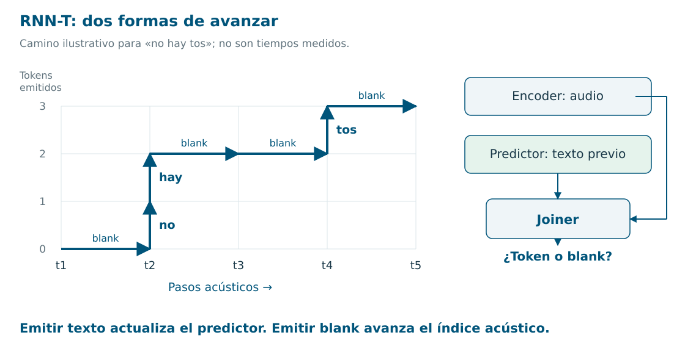
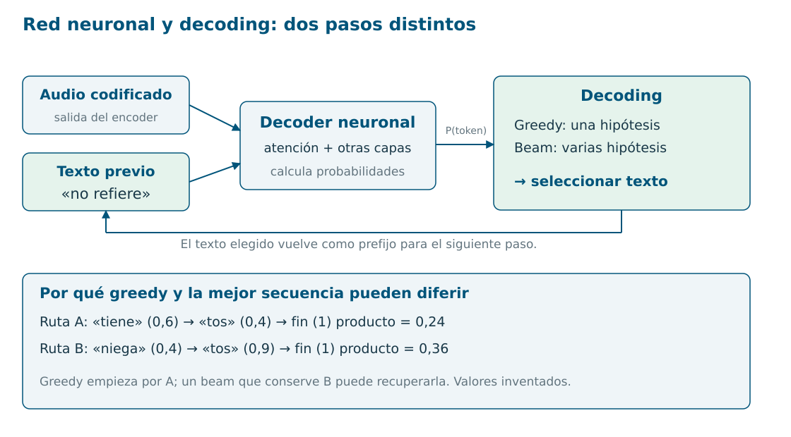
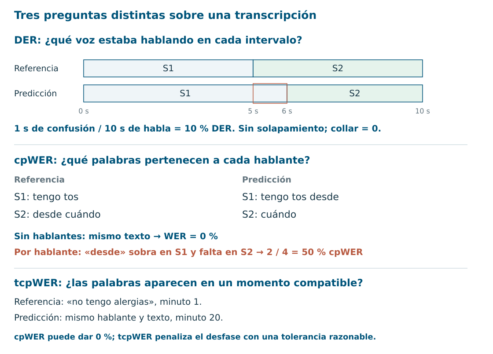
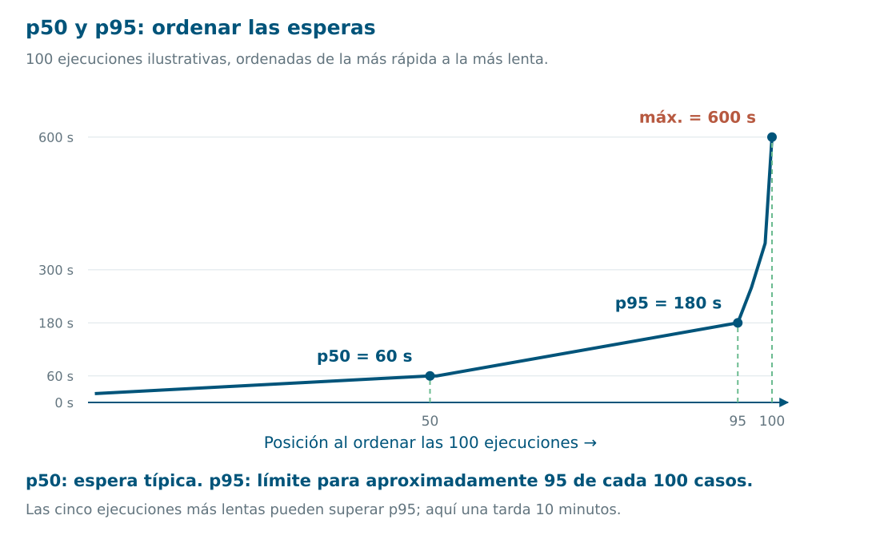

# Audio, hablantes y métricas: entender las piezas

Esta ficha acompaña la presentación técnica. Empieza por las imágenes y después lee los ejemplos. Todos los números y diálogos ilustrativos son inventados; no son resultados de nuestros modelos. El [índice de la guía](guia-intuicion.md) conecta esta parte con [generación y verificación](intuicion-generacion-verificacion.md) y con la [explicación de los papers](intuicion-papers.md).

## 1. El problema común: el audio y el texto no tienen la misma longitud

Una frase corta contiene muchísimos valores de audio. Tras extraer características y pasar por el encoder, seguimos teniendo una secuencia de pasos acústicos. El texto, en cambio, tiene pocos tokens: letras, subpalabras o palabras, según el modelo.

Además, durante entrenamiento solemos conocer **lo que se dijo**, pero no el instante exacto de cada token. CTC, RNN-T y encoder–decoder con atención resuelven de distintas maneras esa correspondencia. No son tres tipos de espectrograma ni tres tipos de convolution.

**Encoder** significa aquí la red que convierte el audio en representaciones útiles. Puede contener convoluciones, atención, recurrencia o combinaciones. La familia de ASR se distingue también por cómo produce y entrena la salida. [Prabhavalkar et al., survey de ASR, §II](https://arxiv.org/abs/2303.03329).

### Qué hay dentro de un encoder acústico


[Versión SVG editable](assets/intuicion/encoders.svg).

Una ruta concreta para imaginarlo es la de **Whisper**: audio → log-Mel → convoluciones → bloques Transformer → secuencia de vectores. Las convoluciones detectan patrones locales y una de ellas reduce la resolución temporal; los bloques Transformer combinan información entre posiciones. La salida todavía no es una transcripción. [Whisper, §2.2](https://arxiv.org/abs/2212.04356).

**Log-Mel** es una representación de cómo cambia la energía por bandas de frecuencia. El encoder transforma esas características en `h1, h2, h3…`: una lista de números por paso. No hay una casilla cuyo significado garantizado sea «la palabra alergia» ni una posición obligatoria por palabra.

**¿Por qué combinar convoluciones y atención?** Las primeras capturan patrones locales; la atención conecta posiciones más lejanas. Conformer combina ambas dentro de sus bloques, además de reducir la secuencia en la entrada. Es otra implementación del encoder, no una cuarta forma de colapsar texto junto a CTC/RNN-T/atención. [Conformer, §2 y figura 1](https://arxiv.org/abs/2005.08100).

### Encoder acústico frente a speaker encoder

Para ASR interesa conservar la evolución temporal de los sonidos y obtener texto. Para comparar voces interesa resumir rasgos de un **segmento** en un vector. Un speaker encoder suele aplicar **pooling**: agregar muchos pasos acústicos, por ejemplo mediante medias y variación, para producir una representación de longitud fija.

Eso permite comparar segmentos de duraciones diferentes. La diferencia clave es el objetivo de entrenamiento y la salida que necesitamos: **secuencia para reconocer habla; vector por segmento para comparar voces**. No implica que ambas redes eliminen perfectamente toda información ajena a su tarea. [x-vectors, arquitectura y statistics pooling](https://www.danielpovey.com/files/2018_icassp_xvectors.pdf).

## 2. CTC: predecir etiquetas y comprimirlas

**Connectionist Temporal Classification.** En cada paso acústico se predice un token o un símbolo **blank**: «no emitir un token aquí». Blank no significa necesariamente que el paciente esté callado.


Si tu lector no anima el GIF, abre la [imagen final](assets/intuicion/ctc-poster.png).

El ejemplo usa letras para que se vea:

```text
Una ruta:            t t _ o o _ s s
Colapsar repetidos:   t   _ o   _ s
Quitar blank:        t     o     s
Texto:               tos
```

El orden importa: `l _ l` produce `ll`, porque el blank separa las dos eles. Si eliminas blank antes de colapsar, obtendrías el resultado incorrecto.

El GIF muestra **una ruta de salida**. Durante entrenamiento, CTC suma las probabilidades de todas las rutas compatibles con la transcripción. Así aprende sin fronteras anotadas palabra por palabra. [Graves et al., CTC original, §3–4](https://www.cs.toronto.edu/~graves/icml_2006.pdf).

**Intuición:** el modelo puede dedicar muchos pasos al mismo sonido; luego comprimimos la secuencia de etiquetas. Su salida básica no recibe explícitamente los tokens previamente emitidos. El encoder sí puede aprovechar contexto acústico, y el decoding puede incorporar búsqueda o un modelo de lenguaje. [Jurafsky y Martin, cap. 16, §16.5](https://web.stanford.edu/~jurafsky/slp3/16.pdf).

## 3. RNN-T: avanzar por el audio o añadir texto

**Recurrent Neural Network Transducer.** Tres piezas cooperan:

| Pieza | Qué aporta |
|---|---|
| Encoder | Representación del paso acústico actual. |
| Predictor | Representación del texto que ya se emitió. |
| Joiner, o red conjunta | Combina ambas y calcula probabilidades de salida. |



En RNN-T básico hay dos movimientos:

- **Emitir un token:** añadir texto, actualizar el predictor y mantener el índice acústico.
- **Emitir blank:** avanzar un paso acústico, manteniendo el texto previo.

Puede emitir varios tokens en un mismo paso acústico. Por ejemplo, en el dibujo «no» y «hay» salen en `t2`; los pasos no representan necesariamente segundos ni palabras.

**Intuición:** combina «qué estoy oyendo» con «qué llevo escrito». Durante entrenamiento también considera rutas de alineamiento posibles, sin exigir marcas exactas por palabra. [Graves, transducer original](https://arxiv.org/abs/1211.3711).

Permite una producción incremental del texto; el streaming completo depende también de que el encoder pueda trabajar con audio parcial. El nombre RNN-T es histórico: no obliga a que todo el sistema moderno sea una RNN. [Survey de ASR, §II-C](https://arxiv.org/abs/2303.03329).

**¿Sigue usándose?** Sí: [Parakeet TDT v3](https://huggingface.co/nvidia/parakeet-tdt-0.6b-v3) es un transducer moderno. TDT predice también duraciones para saltar pasos acústicos; no es idéntico al RNN-T básico del dibujo. CTC sigue teniendo modelos actuales, como [Parakeet CTC](https://huggingface.co/nvidia/parakeet-ctc-1.1b).

## 4. Atención: escribir consultando el audio

En un encoder–decoder con atención, el encoder representa el audio y el decoder genera texto token a token. Para cada decisión consulta el texto anterior y las representaciones acústicas.

La **atención** calcula cuánto peso dar a distintas representaciones. Por ejemplo, al generar el siguiente token después de «no refiere», el decoder combina información de las posiciones acústicas que le resultan útiles. No es una frontera exacta de palabra ni una explicación clínica de por qué se escribió algo. [Atención para ASR](https://arxiv.org/abs/1506.07503).

En **Whisper**, el decoder es un Transformer: atención al texto previo, atención al audio y capas feed-forward. Hay un encoder de audio separado. **No es simplemente una convolution que transforma audio en una frase.** [Whisper, §2.2 y figura 1](https://arxiv.org/abs/2212.04356).



### Decoder neuronal ≠ algoritmo de decoding

La red produce probabilidades. Después elegimos una secuencia:

- **Greedy:** conservar solo la opción más probable en cada decisión.
- **Beam search:** mantener varias hipótesis parciales y explorar sus continuaciones.

En el ejemplo de la figura, greedy empieza por «tiene», pero la ruta «niega tos» termina con mayor producto de probabilidades. Un beam que conserve esa alternativa puede recuperarla. Es una ilustración de búsqueda; mayor probabilidad del modelo no demuestra mayor corrección clínica.

CTC también tiene decoding, aunque carezca del decoder autoregresivo de Whisper. Tampoco garantiza que elegir la etiqueta más probable en cada frame produzca el texto más probable tras sumar rutas. [CTC, §3.2](https://www.cs.toronto.edu/~graves/icml_2006.pdf).

| Familia | Frase para explicarla oralmente |
|---|---|
| CTC | «Predice etiquetas sobre el audio y luego comprime repeticiones y blanks». |
| RNN-T | «Usa audio y texto previo; decide entre emitir texto y avanzar el audio». |
| Atención | «Genera texto consultando las representaciones del audio y lo ya escrito». |

Estas familias conviven. Las fechas de los papers de la slide no significan que una haya sustituido completamente a la anterior.

## 5. Diarización, rol y sujeto clínico

**Diarizar** es agrupar intervalos de audio por identidad de hablante: «esta voz reaparece aquí». Las etiquetas S1/S2 son arbitrarias; no significan paciente/médico. Los modelos pueden agrupar vectores de voz o predecir directamente actividades simultáneas de hablantes. [Park et al., revisión de diarización](https://arxiv.org/abs/2101.09624).

| Pregunta | Tarea |
|---|---|
| ¿Qué intervalos pertenecen a la misma voz? | Diarización. |
| ¿Esa voz corresponde al médico o al paciente? | Identificación del rol. |
| ¿El síntoma mencionado corresponde al paciente o a su madre? | Atribución clínica del contenido. |

Ejemplo inventado:

```text
S1, paciente:   «No soy alérgico. Mi madre sí, a penicilina».
S2, acompañante: «Yo también soy alérgica a penicilina».
```

Saber quién habla ayuda a separar personas, pero sigue haciendo falta interpretar «mi madre». Una diarización perfecta no basta para rellenar correctamente la alergia del paciente.

Otro caso: el paciente propone suspender un fármaco y el médico decide mantenerlo. Atribuir las intervenciones permite distinguir una petición del plan clínico. Son **casos para incluir en nuestra evaluación**, no cifras publicadas de mejora.

### Embeddings: poner segmentos parecidos en el mismo grupo


[Versión SVG editable](assets/intuicion/embeddings-voz.svg).

Un **embedding de voz** es una lista de números que sirve para comparar segmentos. Queremos que la voz de una persona resulte parecida a sí misma aunque diga palabras distintas, y que pueda distinguirse de otras voces.

En un entrenamiento típico, la red aprende a distinguir **identidades de hablante** en grabaciones etiquetadas. Después aprovechamos una representación interna para comparar voces nuevas; no necesitamos que pertenezcan a las identidades de entrenamiento. [Snyder et al., x-vectors, §2.3 y §3](https://www.danielpovey.com/files/2018_icassp_xvectors.pdf).

**Coseno** compara la dirección de dos vectores; un valor alto indica parecido según esa representación. **Clustering** decide qué segmentos agrupar a partir de esas similitudes. En la figura, e1/e3 forman S1 y e2/e4 forman S2. El dibujo en dos dimensiones solo explica la agrupación.

TitaNet es un ejemplo de speaker encoder: convoluciones y pooling con atención producen un vector por segmento; después se pueden comparar y agrupar vectores para diarización. [TitaNet, arquitectura y diarización](https://arxiv.org/abs/2110.04410).

El vector **no incluye un nombre o rol garantizado**. Ruido, canal y segmentos breves o mezclados pueden alterar la representación y la agrupación. Un esquema modular necesita resolver también detección de habla, fronteras y solapamiento; «embedding + clustering» describe su idea central, no todos sus pasos. [Revisión de diarización](https://arxiv.org/abs/2101.09624).

### EEND: predecir directamente actividades de hablantes


[Versión SVG editable](assets/intuicion/eend.svg).

**End-to-End Neural Diarization** formula la tarea como actividades por tiempo: para cada paso, ¿está activo S1?, ¿está activo S2? Una red recibe características acústicas y devuelve una probabilidad para cada salida.

No necesita una fase separada de extracción de embeddings y clustering. Sí tiene representaciones internas. La clasificación es **multietiqueta**: las salidas de dos hablantes pueden estar activas a la vez, como en `t3` del dibujo. Esa propiedad permite representar solapamiento. [EEND original](https://arxiv.org/abs/1909.05952).

El original usa una BLSTM, que procesa una secuencia hacia delante y atrás. Una variante usa atención Transformer para relacionar posiciones de esa secuencia. «Red temporal» aquí significa que procesa pasos de audio; no implica una sola arquitectura concreta. [EEND con self-attention](https://arxiv.org/abs/1909.06247).

**PIT, permutation-invariant training:** en la referencia llamamos A/B a las voces, pero la red puede asignarlas a sus salidas en orden B/A. Comparamos ambas correspondencias y entrenamos con el menor error. La correspondencia se aplica a **toda la secuencia**, no se intercambia libremente en cada frame. Así penalizamos actividades incorrectas, sin castigar nombres arbitrarios de los canales. Esa comparación usa una loss de actividades —entropía cruzada binaria en el original—; DER es la métrica de evaluación. [Objetivo de EEND, §2.2](https://arxiv.org/abs/1909.05952).

| Ruta | Intuición y decisión pendiente |
|---|---|
| Embeddings + clustering | Comparar segmentos de voz; inspeccionar agrupaciones y sus fallos. Resolver ventanas y solapamientos. |
| EEND | Predecir actividades conjuntamente, incluido solapamiento. El manejo del número de hablantes y la duración depende de la variante. |

Ninguna de las dos identifica automáticamente «médico/paciente» ni convierte el audio en nota. Seguimos evaluando la atribución y el contenido final.

### Qué evidencia tenemos de que ayuda

[Speaker Role Identification in Clinical Conversations](https://pmc.ncbi.nlm.nih.gov/articles/PMC12952674/) compara señales lingüísticas con/sin identificadores de hablante: reporta **82 % de accuracy/F1 con texto y 95 % incorporando identificadores correctos**, usando segmentación de referencia. Esto demuestra una mejora en identificación de roles, no un aumento del 13 % en calidad final de notas. Los identificadores incorrectos pueden perjudicar.

En [Wang/SCRIBE](https://doi.org/10.1038/s41746-025-01622-1), distorsionar roles produce poco cambio en sus métricas automáticas de nota, salvo BERT F1. Una consulta de dos participantes puede aportar pistas lingüísticas suficientes; con acompañantes o respuestas ambiguas, el riesgo de atribución cambia. Nuestra hipótesis debe comprobarse en esos casos, conservando el mismo texto/generador y variando la atribución.

## 6. WER, DER, cpWER y tcpWER



### WER: errores de palabras

**Word Error Rate = (sustituciones + eliminaciones + inserciones) / palabras de referencia.** Se busca un alineamiento que minimice las operaciones necesarias.

```text
Referencia:  no tengo fiebre
Predicción:  sí tengo fiebre
             ↑ una sustitución
WER = 1 / 3 = 33,3 %
```

La palabra «no» pesa igual que cualquier otra. WER no dice cuánto daño clínico causó el error; por eso necesitamos análisis específico de negaciones, dosis, entidades y nota final. [Jurafsky y Martin, cap. 16, §16.6](https://web.stanford.edu/~jurafsky/slp3/16.pdf).

### DER: errores de tiempo de hablante

**Diarization Error Rate = (habla omitida + falsa alarma + confusión de hablante) / tiempo de habla de referencia.** Se expresa como proporción de tiempo; no cuenta palabras.

En la figura, el cambio de S1 a S2 debía ocurrir en el segundo 5 y se predice en el 6. Es un segundo mal atribuido entre diez: **10 % DER**.

Hay que declarar si se evalúa solapamiento, qué zonas se puntúan y qué **collar** se excluye alrededor de las fronteras anotadas. Aquí usamos collar cero y ningún solapamiento. Con dos personas hablando a la vez, el denominador puede incluir ambos tiempos de hablante, no solo segundos de reloj. [Implementación de referencia dscore](https://github.com/nryant/dscore).

### cpWER: texto correcto en el hablante correcto

**Concatenated minimum-Permutation Word Error Rate.** Concatenar el texto de cada hablante, probar el mejor emparejamiento entre etiquetas y calcular errores de palabras por hablante.

En la figura, «desde» se mueve de S2 a S1. Sin hablantes, ambas secuencias dicen «tengo tos desde cuándo»: **WER 0 %**. Por hablante, hay una inserción y una eliminación: **cpWER 2/4 = 50 %**.

La permutación evita penalizar un cambio arbitrario de nombres. Si intercambiamos S1 y S2 en toda la predicción, pero sus intervenciones siguen bien agrupadas, cpWER puede seguir en cero. No demuestra que el sistema haya identificado quién es el médico. [MeetEval, definición e implementación](https://github.com/fgnt/meeteval).

### tcpWER: añadir compatibilidad temporal

**Time-Constrained minimum-Permutation Word Error Rate.** Añade restricciones temporales al alineamiento: una palabra no puede emparejarse con otra arbitrariamente lejana.

Si «no tengo alergias» se dice en el minuto 1, pero aparece predicho en el minuto 20 con el mismo hablante, cpWER puede dar cero. tcpWER penaliza ese desfase si queda fuera de la tolerancia elegida. Sigue siendo error de palabras; no es el promedio del error en segundos.

Necesita tiempos de palabras o aproximaciones desde los segmentos. Hay que declarar el método y el collar temporal; este collar permite tolerancia en el emparejamiento, **a diferencia del collar de DER que excluye zonas alrededor de fronteras**. [Documentación oficial de tcpWER](https://github.com/fgnt/meeteval/blob/main/doc/tcpwer.md); [paper de MeetEval](https://arxiv.org/abs/2307.11394).

## 7. p50 y p95: cuánto espera el usuario



**Ordena las latencias de menor a mayor.** El percentil indica una posición de esa distribución:

| Medida | Interpretación del ejemplo |
|---|---|
| p50 = 60 s | Aproximadamente la mitad de los casos tarda como máximo un minuto. Es la mediana: la espera típica. |
| p95 = 180 s | Aproximadamente el 95 % tarda como máximo tres minutos. Queda una cola más lenta. |
| Máximo = 600 s | El caso más lento observado tardó diez minutos. |

p95 **no es el máximo**, ni «el modelo tiene 95 % de precisión», ni «el 95 % tarda exactamente eso». Aquí se usa posición ordenada, o *nearest rank*. Otros métodos interpolan entre valores; pequeñas muestras y distintas convenciones pueden dar números diferentes. [NIST, percentiles](https://www.itl.nist.gov/div898/handbook/prc/section2/prc262.htm).

Para el escriba habría que especificar desde cuándo hasta cuándo medimos: por ejemplo, **desde que termina la consulta hasta que se presenta el borrador**. También importa separar arranque frío, duración de consultas, hardware y concurrencia. No compararía p95 de audios de un minuto con p95 de consultas de media hora.

Un ratio útil es **RTF, real-time factor = tiempo de procesamiento / duración del audio**. Procesar veinte minutos de audio en cinco minutos da RTF 0,25, o cuatro veces más rápido que tiempo real. Eso no demuestra que el sistema pueda escuchar en streaming con cinco segundos de retraso: el procesamiento por archivo y la latencia incremental son propiedades distintas.

## 8. Cinco comprobaciones rápidas

1. `l l _ l` en CTC produce ¿`l` o `ll`? **`ll`: colapsar primero y quitar blank después.**
2. ¿RNN-T puede emitir dos tokens en un paso acústico? **Sí; actualizar el texto no obliga a avanzar el audio.**
3. ¿Una convolution es «el decoder»? **Depende del modelo; en Whisper el decoder es un Transformer.**
4. ¿WER cero demuestra buena atribución? **No; el ejemplo tiene cpWER 50 %.**
5. ¿p95 de tres minutos significa que nadie espera más? **No; aproximadamente el 5 % puede superar ese tiempo.**

Los [visuales y su script](assets/intuicion/generar_visuales.py) son propios. El GIF usa Pillow; no se necesita Manim. Los enlaces a fuentes están junto a las explicaciones, y las ilustraciones no reproducen figuras de terceros.
