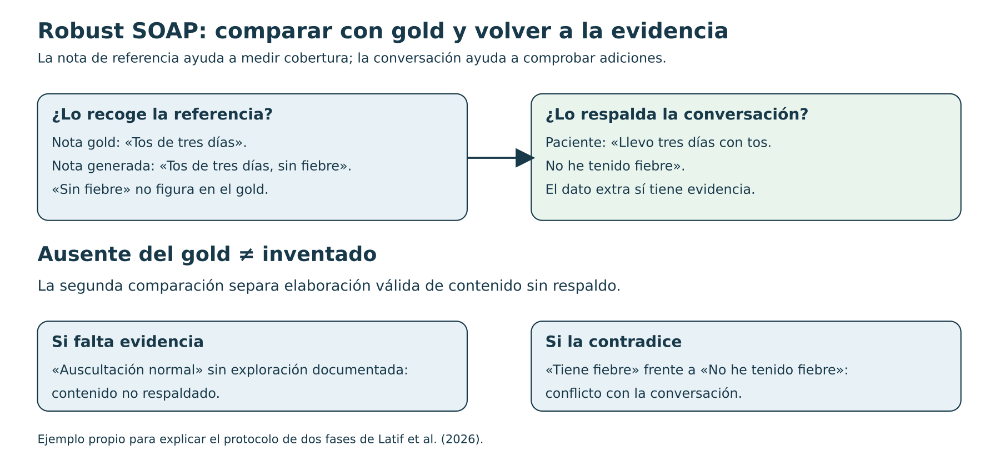
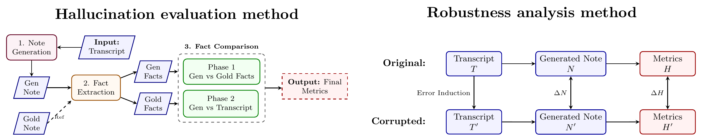
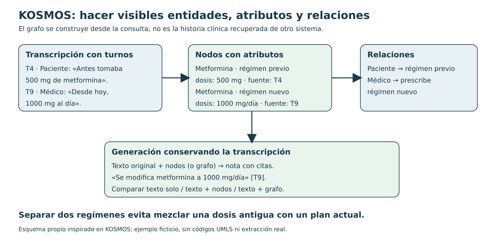
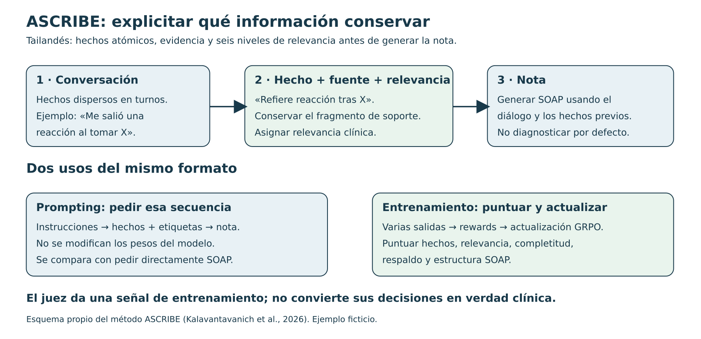

# Cuatro papers para entender de diálogo a nota

Guía de intuición · 12/10/2026 · Lectura aproximada: 15 minutos. Los ejemplos en español son propios y ficticios; las cifras se identifican como resultados de los artículos. Para generación, jueces y SCRIBE de Wang, continuar con [intuicion-generacion-verificacion.md](intuicion-generacion-verificacion.md).

Primero ubica qué pregunta responde cada trabajo:

| Trabajo | Pregunta principal | Qué hace explícito |
|---|---|---|
| **Robust SOAP** | ¿La nota conserva los hechos y qué pasa si alteramos la transcripción? | Comparación con referencia y comprobación de hechos contra la conversación. |
| **KOSMOS** | ¿Ayuda estructurar la consulta antes de redactar? | Entidades, atributos, relaciones y fuentes. |
| **ASCRIBE** | ¿Cómo seleccionar información clínicamente relevante y entrenar ese comportamiento? | Hechos, evidencia, relevancia y señales de entrenamiento. |
| **Nuance / Chain-of-Clinical-Facts** | ¿Ayuda generar un plan de hechos antes del texto? | Un prefijo de hechos generado por el mismo decoder. |

**SCRIBE y ASCRIBE son trabajos distintos.** SCRIBE es el marco de evaluación de Wang et al. que mostramos en la presentación. ASCRIBE es el trabajo en **tailandés**, no vietnamita, explicado aquí. Robust SOAP también propone evaluación, pero con otro protocolo.

## 1. Robust SOAP: la referencia no contiene necesariamente toda la información

**Idea que recordar:** si una frase no aparece en la nota de referencia, todavía no sabemos si está inventada. Hay que volver a la conversación.



**El protocolo del paper.** Parten de **51 consultas** de PriMock57 tras depurar referencias. Un LLM genera SOAP desde texto. Extraen hechos atómicos de nota generada, nota gold y transcripción, organizados con QNOTE y fragmento de fuente. Comparan hechos generados con gold para medir cobertura, omisión y contradicción; los que no figuran en gold se contrastan después con la conversación. Si tienen soporte, son elaboraciones válidas; si no, contenido sin respaldo.

Para robustez, introducen **un error textual por caso** y comparan las notas obtenidas con entrada original y alterada: analizan **44 errores inducidos**. No entrenan un generador nuevo ni ejecutan ASR o diarización. Aproximadamente **92 %** del contenido inicialmente ausente del gold resulta respaldado por el diálogo. La evaluación depende de LLM; perturbar texto aisladamente no reproduce todas las dificultades del audio real. [Latif et al., 2026: §§4–5 y figura 1](https://proceedings.mlr.press/v333/latif26a.html).



*Figura original recortada sin modificar: Latif et al., CHIL 2026, PMLR 333, p. 452. Copyright de los autores. Es distinta de la figura de SCRIBE utilizada en las diapositivas.*

### Un ejemplo para recorrer las dos fases

Supongamos estas tres entradas:

```text
Conversación: «Tos desde hace tres días. No he tenido fiebre».
Gold:        «Tos de tres días».
Generada:    «Tos de tres días, sin fiebre».
```

En la primera comparación, «sin fiebre» parece un añadido porque falta en gold. En la segunda, aparece su evidencia. Penalizarlo como alucinación sería un fallo del evaluador. En cambio, «auscultación normal» carece de soporte si no hay exploración documentada.

Otra cuestión es **qué debía entrar en la nota**. Una frase puede estar respaldada y ser irrelevante para el objetivo. Fidelidad, cobertura y utilidad clínica son preguntas relacionadas, pero distintas.

### Qué podríamos copiar

Primero generar desde transcripción revisada; después alterar una negación, dosis o sujeto manteniendo el resto constante. Comparar los hechos finales y pedir a clínicos que auditen una muestra del evaluador. Así sabemos qué cambio desencadena el error.

Una segunda etapa usaría el audio y ASR reales. Allí los errores pueden aparecer juntos y afectar también a turnos y atribución. Ese experimento ampliaría el del paper: todavía tendríamos que construirlo.

**Leer primero:** figura 1 → §4.1.3, las dos fases → §5.1.2, perturbaciones. La [ficha existente](robust-soap.md) aclara cómo leer sus tablas y sus límites.

**Comprueba si lo captaste:** ¿puede una nota tener alta cobertura del gold y, aun así, incluir información inventada? Sí: cubrir los hechos esperados no elimina las adiciones sin soporte.

## 2. KOSMOS: estructurar lo que ya está en la consulta

**Idea que recordar:** construir una ficha organizada de la conversación antes de pedir la nota. Un grafo añade relaciones a esa ficha.



### Cómo viaja la información

El código divide y contextualiza turnos, extrae menciones y las agrupa como entidades; conserva atributos y procedencia. Usa UMLS para normalizar conceptos y construye relaciones entre nodos. El generador recibe **grafo solo**, **transcripción + nodos**, o **transcripción + grafo**. El repositorio conserva artefactos intermedios para inspección. Esta búsqueda en terminologías es diferente de recuperar historia de un paciente. [Repositorio y flujo de KOSMOS](https://github.com/ryanwaynehenry/KOSMOS), [pipeline publicada](https://github.com/ryanwaynehenry/KOSMOS/blob/main/src/clinical_kg/pipeline.py).

Ejemplo propio: «Antes tomaba 500; desde hoy serán 1000 al día». La tarea incluye resolver **500 de qué**, quién toma el fármaco y cuándo cambia la pauta. Si extraemos dos cantidades sin sus relaciones, podemos escribir una dosis incorrecta aunque los números estén bien reconocidos.

Piensa en tres niveles:

- **Mención:** una expresión encontrada, como «500 mg» en T4.
- **Nodo con atributos:** el régimen previo de ese medicamento, con dosis y fuente.
- **Relación:** quién usa ese régimen o quién prescribe el nuevo.

Normalizar «falta de aire» a un concepto estable puede ayudar a organizar términos. Pero un código no demuestra el diagnóstico: una normalización demasiado específica añade información que el diálogo quizá no respalda.

### Qué entrenan y cómo lo evalúan

El estudio usa GPT-5.2 en sus etapas LLM; no presenta un nuevo entrenamiento supervisado de esa pipeline. Compara variantes sobre los tres tests de ACI-BENCH mediante métricas de nota, hechos y citas. Las mejores variantes conservan la transcripción. Las mejoras de recall por hechos frente al baseline fuerte son **modestas y no significativas**; hay mejora de citas. No miden independientemente la extracción ni demuestran ahorro de revisión en una consulta real. [Henry y Gong, 2026: §§2–4 y limitaciones](https://doi.org/10.3390/info17040355).

### Qué podríamos copiar

Empezaría con **hecho + atributos + fuente**, conservando el texto original. Compararía esa lista con transcripción sola. Solo añadiría relaciones si resuelven errores observables, como mezclar antecedentes familiares con problemas del paciente. El resultado de KOSMOS no permite dar por hecho que un grafo completo supera una lista más sencilla.

**Leer primero:** §2.1 y figuras 2–3 para el flujo; §2.6 para atributos; discusión de nodos frente a relaciones; limitaciones. **Pregunta clave:** si falla la nota, ¿lo que faltaba ya se perdió al extraer el grafo?

## 3. ASCRIBE: hechos con evidencia y relevancia, en tailandés

**Idea que recordar:** pedir al modelo que organice qué información conservar antes de redactar; después estudiar si ese comportamiento puede enseñarse mediante entrenamiento.



### Primero, la versión sin entrenamiento

El prompt pide una secuencia: extraer **hechos autocontenidos**, aportar evidencia, asignar relevancia y producir la nota. La relevancia tiene seis niveles: impacto diagnóstico, impacto en tratamiento, documentación requerida, seguimiento, referencia futura e información innecesaria. Son criterios del trabajo y su contexto clínico; no una clasificación universal. [Prompt completo publicado](https://github.com/loolootech/ascribe/blob/main/prompts/ascribe_prompt.py).

Un ejemplo propio:

```text
Paciente: «Tuve una reacción al tomar X».

Hecho:    el paciente refiere una reacción después de tomar X.
Soporte:  el fragmento anterior.
Etiqueta: debe conservarse según los criterios clínicos acordados.
Nota:     documentar lo referido, con la incertidumbre que corresponda.
```

La extracción no debería convertir «reacción» en «anafilaxia» por plausibilidad. Ni conservar un fragmento de soporte garantiza que la paráfrasis sea correcta: también hay que comprobar la relación entre ambos.

Estos hechos se generan **antes de la nota en la misma secuencia**. Son una salida visible del modelo. No prueban que su razonamiento interno haya seguido exactamente ese recorrido.

### Dos jueces, dos direcciones de la comparación

**ClaimEntailment (CE):** para cada hecho de referencia pregunta si la nota lo conserva. Es una medida de completitud parecida a recall. CE-Impact aplica la misma idea solo a los hechos de los tres niveles prioritarios. [Prompt de CE](https://github.com/loolootech/ascribe/blob/main/prompts/ce_prompt.py).

**SOAPPrecision (SP):** para cada entrada de la nota pregunta si está respaldada por la conversación. Cuenta entradas respaldadas sobre entradas generadas. [Prompt de SP](https://github.com/loolootech/ascribe/blob/main/prompts/sp_prompt.py).

Ejemplo numérico propio:

```text
Referencia: 4 hechos que deberían conservarse.
Nota:       conserva 3 de ellos e inventa 1 entrada adicional.

CE: 3 / 4 = 75 %.
SP: 3 / 4 = 75 %, si cada entrada contiene un solo hecho.
```

Si una entrada agrupa varios hechos, los denominadores dejan de ser intercambiables. Y si la referencia de hechos omite información importante, CE tampoco puede premiar que se conserve. Necesitamos validar tanto referencias como juicios.

### Después, enseñárselo a un modelo

El paper estudia SFT con LoRA y GRPO. Para SFT, proporciona salidas objetivo; algunas incluyen hechos antes de SOAP. Para GRPO, combina cinco rewards: extracción de hechos, etiquetas de relevancia, formato, completitud y respaldo factual. Usa datos reales y sintéticos; estos últimos se generan desde notas mediante conversaciones de agentes.

ICOPD tiene **400 encuentros privados**: 300/50/50 para train/validación/test. S-ICOPD aporta **295 diálogos sintéticos de entrenamiento y 50 de validación**. ThaiClinicBench contiene **44 encuentros reales externos**. En este último, GPT-5.4 con su prompt aumenta CE de **55,7 a 62,6** y CE-Impact de **64,3 a 74,6**. Son puntuaciones del juez, no porcentajes de beneficio clínico. La validación del juez incluye un médico; no demuestra generalización al español. Parte de la evaluación también interviene en el reward. [Kalavantavanich et al., 2026: §§3–7 y apéndices D–E](https://arxiv.org/abs/2610.01234).

La intuición de GRPO: generar varias respuestas al mismo caso, puntuarlas y aumentar la probabilidad de las relativamente mejores. **El reward define qué aprende a optimizar.** Si el juez premia una frase respaldada superficialmente pero clínicamente equivocada, el entrenamiento puede reforzar ese error.

### Qué podríamos copiar

Primero probar prompting directo frente a hechos + evidencia + nota, con criterios de selección acordados con nuestros médicos. Después calibrar CE/SP o sus equivalentes con anotaciones españolas. Fine-tuning y GRPO vendrían cuando tengamos datos, baseline y una evaluación suficientemente fiable; un reward automático no sustituye ese trabajo.

**Leer primero:** figura 1 y §3.1 → prompt A.3 → §5 y prompts CE/SP → limitaciones. §3.2 y figura 2 cuando quieras entender el entrenamiento.

**Pregunta para defenderlo:** ¿está mejorando la documentación o está aprendiendo a agradar a nuestro juez? Hay que contrastar ambas posibilidades mediante evaluación clínica independiente.

## 4. Nuance: el antecedente de generar hechos antes del texto

Singh et al. entrenan un Transformer encoder–decoder con pointer-generator para secciones de nota, usando aproximadamente **900.000 encuentros privados**. Extraen hechos de las notas de referencia con una herramienta propietaria y los anteponen al texto objetivo. En inferencia, el decoder **predice esos hechos desde la transcripción y después genera la nota**. No recibe hechos gold del caso ni recupera historia HCIS.

Combinan cross-entropy con una loss contrastiva entre candidatos. Evalúan ROUGE-L y coincidencia de hechos básicos o con atributos; esas métricas requieren sus extractores. El resultado interesa como antecedente de planificación, pero ni corpus ni evaluación son directamente reproducibles por nosotros. [Singh et al., 2023: §3.1.2, §3.1.3 y §4](https://aclanthology.org/2023.clinicalnlp-1.18/).

Ejemplo propio de la secuencia objetivo:

```text
[hechos] tos · tres días · niega fiebre
[nota]   Refiere tos de tres días de evolución. Niega fiebre.
```

La diferencia con poner «piensa paso a paso» en un prompt es que aquí **se entrena para producir un prefijo concreto**, con supervisión extraída del gold. La idea transferible es comparar la utilidad de ese prefijo con generar directamente.

## Qué experimento une las ideas sin hacerlo enorme

Para nuestro primer estudio, usaría los mismos casos en dos rutas: **diálogo → nota** y **diálogo → hechos con fuente → nota**, conservando también el diálogo en la segunda. Compararía cobertura, contenido sin respaldo, atribución y esfuerzo de corrección; mediría además tiempo y memoria.

Robust SOAP inspira los errores controlados y la triangulación. KOSMOS inspira atributos y procedencia. ASCRIBE inspira criterios explícitos para seleccionar hechos y jueces separados de cobertura/respaldo. Nuance aporta el antecedente entrenado. Son propuestas para comparar, no una arquitectura ya validada en nuestro entorno.

Antes de implementar, deberías poder explicar con un caso: **qué recibe el generador, qué puede perder el paso intermedio, qué evidencia recibe el juez y quién comprueba al juez**.
